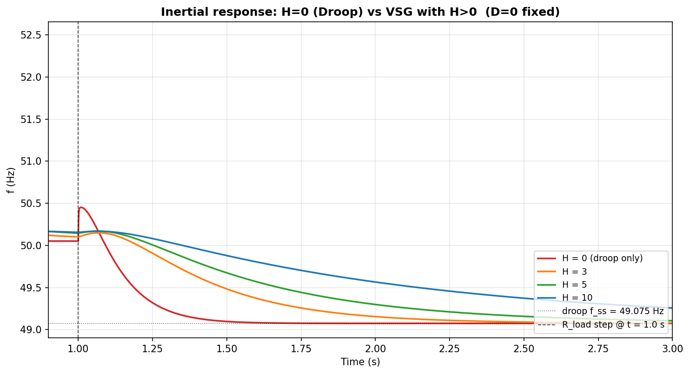
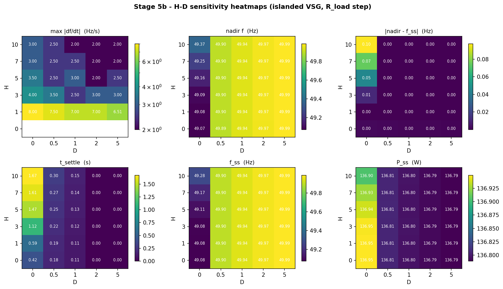
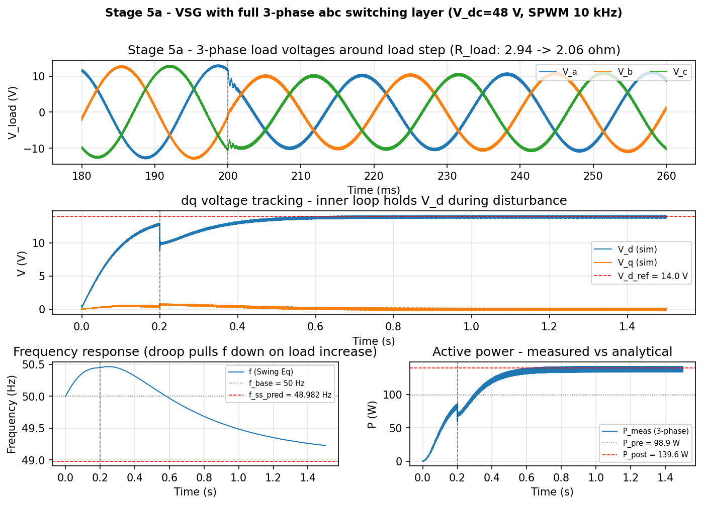
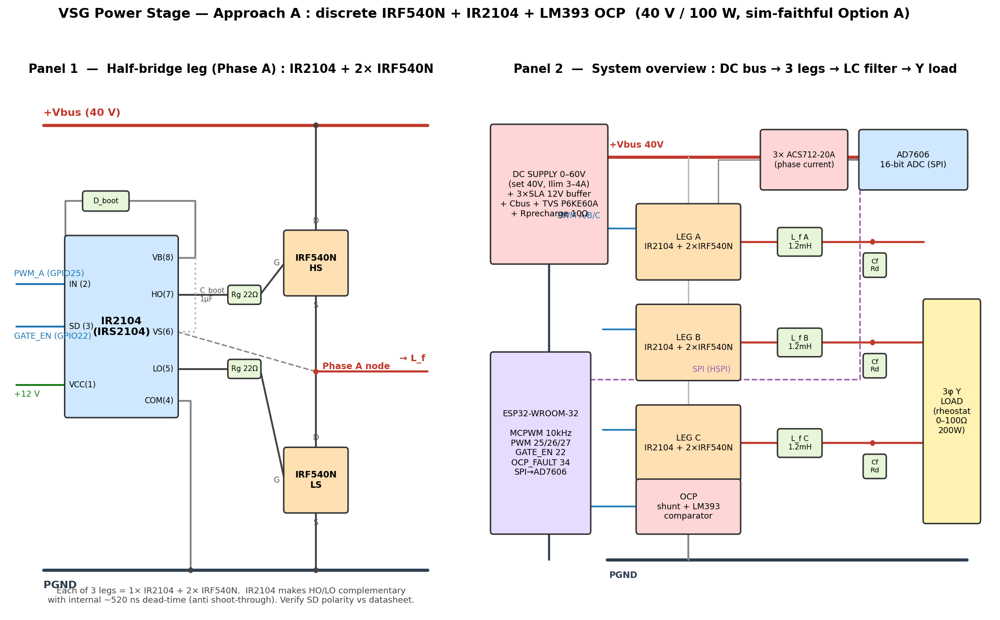
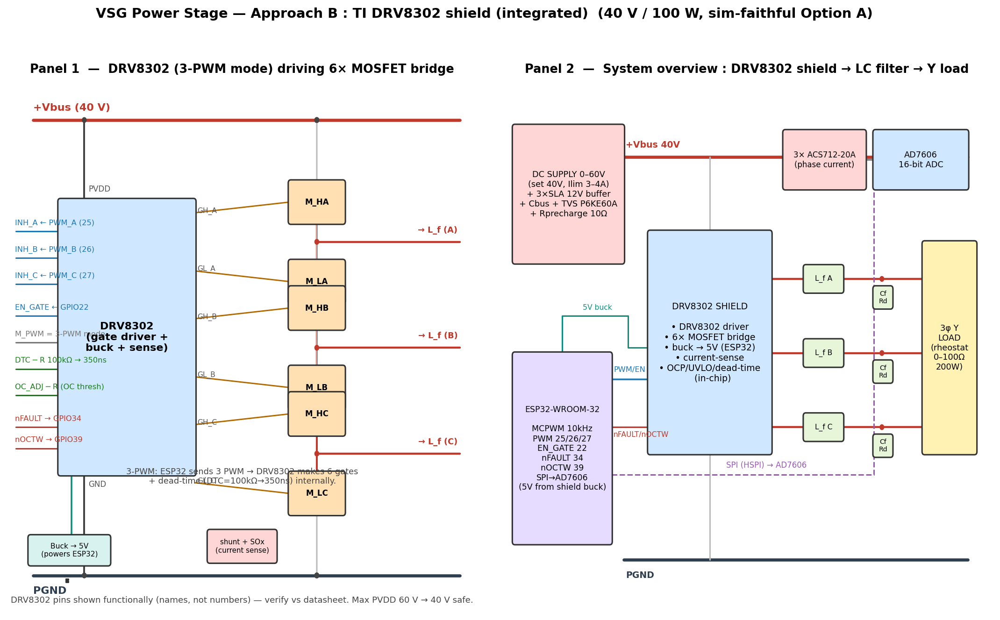

<h1 align="center">⚡ Virtual Synchronous Generator (VSG)</h1>
<p align="center"><b>A grid-forming inverter that fakes the inertia of a real power-plant generator — built from verified simulation all the way to an ESP32 prototype.</b></p>

<p align="center">
  
  
  
  
  
</p>

---

## 🌀 What is this?

A real synchronous generator resists sudden frequency change because its spinning rotor
stores **kinetic energy (inertia)**. Modern inverters have none — so grids full of solar/battery
inverters become fragile. A **Virtual Synchronous Generator** makes an inverter *behave* like
it has inertia and damping, by solving the generator **swing equation** in software and driving
the output accordingly.

This project develops one end-to-end:
**MATLAB/Simulink model → analytical verification → ESP32 firmware → hardware prototype.**

> **Author:** Chinnawat Dumklang (Napoleon) · Suranaree University of Technology (SUT), Electrical Engineering
> **Senior project** · islanded / grid-forming (no PLL) · 100 W · 40 V DC bus

---

## 🎯 The headline result

The whole point of inertia in one picture. After a load step at *t* = 1 s, a plain **droop** controller
(H = 0, red) lets frequency crash fast. Adding **virtual inertia** (H = 3 → 10) progressively
*slows the rate of change of frequency* — exactly what a real generator does.

<p align="center">
  
</p>

This came from a **30-case H–D sweep** (inertia × damping), which picked the operating point
**H = 5, D = 0.5** (lowest RoCoF with settling < 0.5 s):

<p align="center">
  
</p>

And the full 3-phase switching model (SPWM, 10 kHz) confirms it works at the converter level:

<p align="center">
  
</p>

---

## ✅ Status

| Part | State |
|---|---|
| Simulation (Stage 1 → 5c) | ✅ **Complete & analytically verified** (<10 % error every stage) |
| H–D sensitivity sweep (30 cases) | ✅ Operating point **H = 5, D = 0.5** |
| Thesis Ch.2 / Ch.3 / Ch.4 / Ch.5 | ✅ Drafted (`docs/thesis/`) |
| ESP32 firmware | ✅ Refactored 2026-07-02 (task-based FPU-safe control, HW MCPWM fault, ACS712 auto-zero) — **compiles clean on core 2.0.17**, not yet bench-tested |
| Hardware build | ⏳ Design locked, parts list ready (budget 7,200 THB) |
| Ch.6 — real-vs-sim results | ⬜ After bench bring-up |

---

## 🔧 Hardware — two power-stage options

Same ESP32 control core, firmware, filter and sensing for both — picked in firmware via
`#define POWER_STAGE`. Full guide: [`docs/notes/power_stage_options.md`](docs/notes/power_stage_options.md).

| | **A — discrete IRF540N + IR2104** *(default)* | **B — TI DRV8302 shield** |
|---|---|---|
| Cost | ~585 THB | ~1,000–1,500 THB |
| Blow-up recovery | ~20 THB / MOSFET | whole board |
| Protection | LM393 OCP + IR2104 dead-time (~520 ns) | integrated (OCP / UVLO / dead-time) |
| Best for | tight budget, self-funded repairs | speed, lower build risk |

<p align="center">
  
  
</p>

---

## 🧮 Locked design point — "Option A" (sim-faithful)

| Param | Value | | Param | Value |
|---|---|---|---|---|
| DC bus `Vdc` | 40 V | | Inertia `H` | 5 s |
| AC setpoint `V_set` | 14 V peak/phase (m = 0.70) | | Damping `D` | 0.5 |
| Power | 100 W (3-phase) | | Droop `R_p` / `R_q` | 0.05 / 0.05 |
| Filter `L_f` / `C_f` / `R_d` | 1.2 mH / 10 µF / 1 Ω | | Switching | 10 kHz SPWM |

Swing law (CSV-verified):
`(2H/ω_s)·dω/dt = [P_set + (1 − ω/ω_s)/R_p] − P_e − D·(ω − ω_s)`
→ at H = 5, D = 0.5 gives `f_ss = 49.898 Hz` (simulation: 49.896 Hz).

---

## 📁 Repository structure

```
vsg-project/
├── matlab/                 # programmatic Simulink builders (Stage 1–5c) + scripts/
├── python/
│   ├── analysis/           # plot_phase*.py, power_stage_{A,B}_wiring.py
│   └── plots/              # generated figures
├── hardware/esp32/vsg_controller/vsg_controller.ino   # ESP32 firmware
└── docs/
    ├── thesis/             # chapter 2–5  (.md + .docx)
    ├── figures/            # showcase figures (this README)
    └── notes/              # power_stage_options, design reconciliation, safety
```

---

## 🚀 Getting started

**Python plots / analysis**
```bash
cd python
python -m venv .venv && .venv/Scripts/pip install -r requirements.txt
.venv/Scripts/python analysis/plot_phase5b_hd_sweep.py
```

**MATLAB (R2018b+)** — run the stage builders in `matlab/`; each builds its `.slx`, simulates,
and exports a `.mat` for the Python plotters.

**Firmware** — open `hardware/esp32/vsg_controller/vsg_controller.ino` in Arduino IDE
(ESP32 core v2.x). Set `POWER_STAGE` to A or B, verify the pin map against your wiring, flash.
⚠️ **Always bench-test with the DC supply current-limited (~3–4 A).**

---

<p align="center"><sub>VSG emulates the swing equation <code>J·dω/dt = Tm − Te − D·(ω − ω0)</code> · Ref: Power System Analysis, Hadi Saadat</sub></p>
