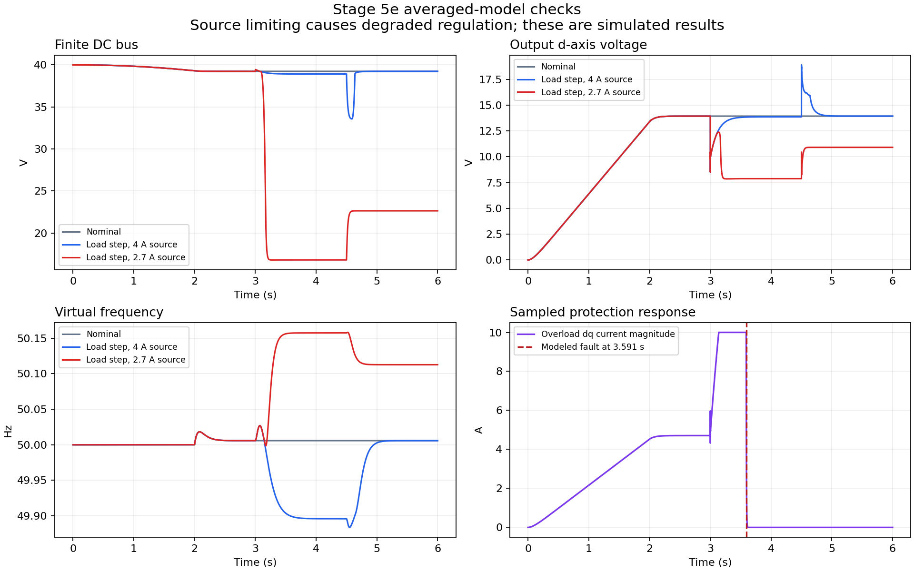

# Virtual Synchronous Generator

Three-phase islanded grid-forming inverter research by Chinnawat Dumklang (Napoleon), Suranaree University of Technology.

The project connects analytical models, switching simulation and ESP32 firmware. The current operating target is **40 V DC / 100 W nominal / 14 V peak per phase / 50 Hz**. Physical prototype qualification remains pending; compilation and model checks do not establish hardware readiness.

## Current design and evidence

Latest integration record: [changes and verification on 2026-10-20](docs/notes/implementation_status_2026-10-20.md).

- [Authoritative design baseline](docs/notes/design_baseline.md): operating point, per-unit values, energy-source scope and toolchain.
- [Independent shutdown and bench plan](docs/notes/hardware_shutdown_and_bench_plan.md): required hardware permit circuit and tests.
- [Thai system wiring manual](docs/notes/wiring_manual_th_2026-10-22.md) and [assembly acceptance worksheet](docs/notes/wiring_acceptance_sheet_2026-10-22.md): firmware signal mapping, power/measurement wiring, unresolved design items and staged bench records; not a released construction schematic.
- [Neutral and voltage sensing Rev A](docs/notes/neutral_voltage_sensing_design_rev_a_2026-10-22.md): selected star-reference topology, differential front end, BoM, logical connections and analytical checks; hardware integration gates remain pending.
- [Whole-prototype budget estimate](docs/notes/complete_prototype_budget_2026-10-22.md): scenario-based allowances with instruments borrowed, separate from verified supplier quotations and excluding unscoped BESS.
- [Firmware validation](docs/notes/firmware_validation_2026-10-13.md): implemented fixes, executed checks and remaining physical tests.
- [Simulation validation](docs/notes/simulation_validation_2026-10-13.md): actual run results and model limitations.
- [Original review](docs/notes/project_review_2026-10-12.md): findings before the changes; historical line numbers.

| Track | Meaning |
|---|---|
| Stages 1–5c | Analytical and continuous-controller switching baselines |
| Stage 5d | Selected discrete-controller effects with per-signal clocks and matched-bandwidth checks |
| Stage 5e | Averaged dq robustness harness; not a switching, THD or hardware proof |
| Stages 5f–5g | Hypothetical induction motor and simulation-only gain sweep: no motor case passes operating criteria; cold-start numerical convergence unresolved |
| Stage 5h | Six gate-driven SPS MOSFETs; bounded nominal/refined electrical checks and layout startup comparison recorded |
| ESP32 firmware | Dry-run default; startup/protection regression and compile checks recorded separately |
| Manual Simulink learning | Stages 1–2 recorded passed; Stage 3 next |
| Hardware / HIL / Chapter 6 | Physical measurements and comparison still required |

## Locked parameters

| Parameter | Value |
|---|---|
| Vdc / nominal power | 40 V / 100 W three-phase |
| Voltage target | 14 V peak phase, approximately 17.15 V RMS line-to-line |
| Lf / Cf / Rd | 1.2 mH / 10 uF / 1 ohm |
| H / D | 5 s / 0.5 (D multiplies rad/s deviation) |
| Rp / Rq | 0.05 / 0.05 |
| Control / PWM target | 10 kHz; actual timing requires measurement |
| Main power stage | IRF540N + IR2104 with independent latched driver permission |

For the implemented swing law, effective static droop is `1/(1/Rp + D*omega_s)`, about **0.565%**, despite the governor parameter Rp = 5%. The historical ~136 W post-step case exceeds the nominal 100 W target and needs a separately qualified hardware overload envelope.

## Hardware architecture


This figure defines required signal flow, not an inspected PCB. The independent latch and driver-disable path must be built and tested. A 24 V battery cannot be directly paralleled with the 40 V bus. BESS chemistry, interface and charge/discharge limits remain hardware design inputs. Use separate regulated auxiliary rails during initial bring-up; a generic LM2596 directly on the nominal 40 V bus has no positive operating-voltage margin.

## Reproduce the simulation checks

The project retains **MATLAB R2018b compatibility**. On Napoleon's machine the licensed installation is `D:\MATLAB1`; R2018b does not support `-batch`.

In MATLAB:

```matlab
cd('D:\workspace\engineering\vsg-project\matlab');
phase5d_discrete;
phase5e_robustness;
```

Stage 5d needs the baseline `D:\workspace\engineering\vsg-project\matlab\vsg_stage5c.slx` and corresponding MAT result from `phase5c_tuned.m`. Rebuild that baseline when absent; do not treat metadata from a different parameter set as equivalent.

New validation artifacts are isolated under `D:\workspace\engineering\vsg-project\matlab\validation_outputs`. Current small JSON reports and selected SLX models are versioned; raw MAT waveforms, rerun backups and logs remain local and must be regenerated when absent. Read each validation report's pass/fail, source hashes and scope. Stage 5d schema version 2 uses `signals.<name>.time` and `.data`; the legacy `t` alias belongs only to frequency/omega. Never pair it with multirate plant waveforms.

### Open the Stage 5h MOSFET model

The repository includes the [original electrical model](matlab/validation_outputs/stage5h/vsg_stage5h_mosfet.slx), the [arranged model with Scopes](matlab/validation_outputs/stage5h/vsg_stage5h_mosfet_layout.slx), and the [Thai layout and Run guide](docs/notes/stage5h_layout_th_2026-10-30.md). With MATLAB R2018b and Simscape Electrical Specialized Power Systems installed:

```matlab
cd('D:\workspace\engineering\vsg-project\matlab');
open_system(fullfile('validation_outputs', 'stage5h', 'vsg_stage5h_mosfet_layout.slx'));
```

Adjust the absolute `cd` path to your clone. Run the model and open its Scopes for fresh results. The [saved overview](docs/figures/stage5h_mosfet_nominal_2026-10-29.png) and [six gate commands](docs/figures/stage5h_pwm_all_six_2026-10-30.png) remain snapshots of the documented runs. Gates are logic commands, not measured electrical Vgs or an IR2104 driver model; the ideal DC source and device assumptions do not establish hardware qualification. Rebuilding the source model uses `build_stage5h_mosfet`; `layout_stage5h_mosfet` produces the arranged copy.

To regenerate the nominal raw MAT waveforms used by the saved-data viewers, run `run_stage5h_mosfet(3, 2.5e-6, 'nominal')` from the same MATLAB directory. This simulates the original Stage 5h model and writes results under `D:\workspace\engineering\vsg-project\matlab\validation_outputs\stage5h`; use your clone's corresponding absolute path.

Firmware build and host-test commands are in the firmware validation report. Use Arduino-ESP32 **2.0.17**; the legacy MCPWM/timer APIs in this project are not a core-3.x implementation. Dry-run must keep the gate request disabled. Do not acknowledge real-power readiness settings merely to bypass compilation checks: those settings record physical qualification, not software test results. No upload/flash is part of the automated validation.

## Thesis and historical material

Markdown chapters under `D:\workspace\engineering\vsg-project\docs\thesis` are the editable source. Dated review DOCX exports are separate from older advisor drafts. Chapters must distinguish historical 48 V sweep results from the current 40 V baseline and model results from physical measurements.

Historical plots remain available for the research narrative:


The H=0 step derivative is sensitive to numerical measurement; it is not a measured hardware RoCoF. Compare inertia settings using consistent damping, disturbance, filtering and measurement windows. Past component prices are dated planning estimates, not current quotations.

## Finite-source study

Latest extension: [motor study and executed results, 2026-10-24](docs/notes/motor_simulation_stage5f_2026-10-24.md). Ten unit tests pass and motor-only ODE45/equivalent-circuit agreement passes, but the coupled motor cases and three gain candidates do not meet operating criteria. Direct-connection integration convergence passes; cold startup still fails after refinement to 2.5 us. Stage 5f intentionally saves a failed overall validation report and raises an assertion. No firmware gains were changed and no real motor has been qualified.



The assumed 2.7 A source-limited case loses voltage regulation without sampled overcurrent/thermal shutdown. It is a test that exposes a limitation, not an acceptable operating point. Physical DC-bus protection and energy absorption remain required design work.
