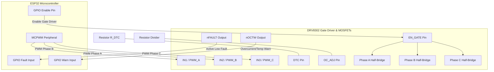
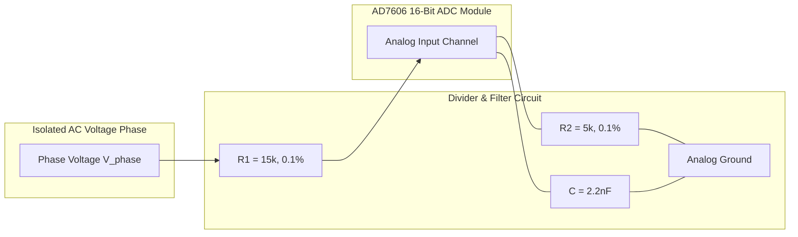
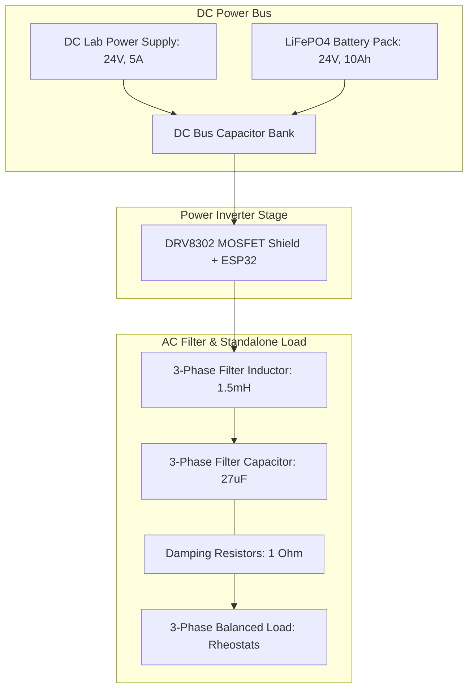

# Virtual Synchronous Generator (VSG) Hardware Safety & Design Handbook
## Safe Low-Voltage (24V–48V DC, 100 VA) ESP32-Controlled 3-Phase Inverter Prototype

---

### Introduction
Welcome, Napoleon! As a 3rd-year engineering student embarking on this design project, you are building a **Virtual Synchronous Generator (VSG)** controlled by an ESP32. A VSG emulates the mechanical and electromagnetic characteristics of a traditional synchronous machine—such as virtual inertia and damping—using a 3-phase Voltage Source Inverter (VSI). 

Following your safety preferences and practical setup goals, this prototype is designed specifically for **Pure Islanded (Grid-Forming / Standalone) Mode**. In this mode, the VSG does not synchronize to an existing grid; instead, it acts as a voltage source that establishes and regulates the local frequency ($\omega$) and voltage amplitude ($E$) for a standalone 3-phase load. This eliminates the need for grid-synchronization elements (like Phase-Locked Loops and grid relays), significantly reducing cost, complexity, and safety hazards.

While industrial VSGs operate at high voltages (e.g., 400V AC or higher) and high power ratings (e.g., 10 kVA to megawatts), developing a prototype at these levels is hazardous and expensive. This handbook provides a complete, mathematically rigorous, and physically safe blueprint to scale down those dynamics to a safe **low-voltage (24V DC, 100 VA) prototype** while maintaining **identical per-unit (pu) system dynamics**. 

This document serves as your reference manual for parameter scaling, component selection, sensor acquisition, laboratory setup, and electrical safety.

---

## 1. Low-Voltage 3-Phase Inverter Power Stage Module

To implement the power stage, we avoid building a discrete MOSFET H-bridge from scratch. High-frequency switching (>20 kHz) requires precise gate drive circuitry, fast rise/fall times, and robust protection against electromagnetic noise, voltage spikes, and short-circuits. Instead, we utilize an **integrated 3-phase MOSFET bridge shield** powered by the **Texas Instruments DRV8302** or **DRV8301** gate driver IC.

### Why the TI DRV8302 / DRV8301?
The DRV8302 is a highly integrated 3-phase gate driver capable of driving external N-channel MOSFETs up to 60V and providing up to 1.7A source and 2.3A sink gate drive current. It is ideal for our 24V–48V prototype due to the following integrated features:
1. **Integrated Buck Regulator:** Contains a switching regulator that steps down the high-voltage DC bus (24V–48V) to a stable 5V output (up to 1.5A) to directly power the ESP32 and peripherals.
2. **Current Shunt Amplifiers:** Features two independent, high-performance, low-noise current-sense amplifiers with adjustable gains (10, 20, 40, or 80 V/V) and external calibration to measure phase currents.
3. **Hardware Protection Suite:**
   - **Overcurrent Protection (OCP):** Monitors the drain-to-source voltage ($V_{DS}$) of each external MOSFET. If the voltage exceeds a hardware-configured threshold set by the `OC_ADJ` pin, the driver shuts down the gates to prevent damage.
   - **Overtemperature Protection (OTP):** Shuts down the IC if junction temperatures exceed 150°C.
   - **Undervoltage Lockout (UVLO):** Prevents operation if the DC bus voltage drops below a threshold, ensuring clean switching transitions.
   - **Shoot-Through Prevention (Dead-Time Control):** Automatically inserts a dead-time (programmed via the `DTC` pin resistor) to ensure that the high-side and low-side switches of a single leg never conduct simultaneously.
4. **Flexible PWM Modes:** Supports both 6-PWM input mode (individual high/low control) and 3-PWM input mode (where the chip automatically generates complementary signals and dead-time from 3 input pins).

### ESP32-to-DRV8302 Hardware Interface
The ESP32 microcontroller features a specialized hardware peripheral called the **MCPWM (Motor Control Pulse Width Modulation)**, which is designed for complementary 3-phase PWM generation.

The system can be configured in **3-PWM mode** (simplifying ESP32 pin requirements and letting the DRV8302 handle dead-time) or **6-PWM mode** (giving the ESP32 absolute control). For safety-first educational prototypes, **3-PWM mode** is recommended as the gate driver acts as a hardware fail-safe.



---

## 2. Mathematical Sizing & Parameter Scaling (10 kVA to 100 VA)

To validate the algorithms on our low-voltage benchtop setup, we must scale the control parameters (virtual inertia $J$, virtual damping $D_p$, reactive droop $K_q$) and the inner loop PI controllers so that **the per-unit (pu) dynamics of the 100 VA prototype are identical to those of a 10 kVA utility-scale system**.

### 2.1 Definition of Base Values
Let the high-power system be index $H$ and the low-power prototype system be index $L$. We define the base values for both systems using line-to-line RMS voltages ($V_{base}$) and 3-phase apparent powers ($S_{base}$). The nominal grid frequency is $f_0 = 50\text{ Hz}$ ($\omega_0 = 2\pi f_0 \approx 314.16\text{ rad/s}$).

| Parameter | High-Power Base Value (H) | Low-Power Base Value (L) | Scaling Ratio ($L/H$) |
| :--- | :--- | :--- | :--- |
| **Apparent Power ($S_{base}$)** | $10,000\text{ VA}$ | $100\text{ VA}$ | $0.01$ |
| **Line-to-Line Voltage ($V_{base}$)** | $400\text{ V}$ | $24\text{ V}$ | $0.06$ |
| **Phase-to-Neutral Voltage ($V_{base\_ph}$)** | $\frac{400}{\sqrt{3}} \approx 230.94\text{ V}$ | $\frac{24}{\sqrt{3}} \approx 13.86\text{ V}$ | $0.06$ |
| **Base Current ($I_{base}$)** | $\frac{S_{base,H}}{\sqrt{3} V_{base,H}} \approx 14.43\text{ A}$ | $\frac{S_{base,L}}{\sqrt{3} V_{base,L}} \approx 2.41\text{ A}$ | $0.1667$ |
| **Base Impedance ($Z_{base}$)** | $\frac{V_{base,H}^2}{S_{base,H}} = 16\ \Omega$ | $\frac{V_{base,L}^2}{S_{base,L}} = 5.76\ \Omega$ | $0.36$ |
| **Base Inductance ($L_{base}$)** | $\frac{Z_{base,H}}{\omega_0} \approx 50.93\text{ mH}$ | $\frac{Z_{base,L}}{\omega_0} \approx 18.34\text{ mH}$ | $0.36$ |
| **Base Capacitance ($C_{base}$)** | $\frac{1}{\omega_0 Z_{base,H}} \approx 198.94\ \mu\text{F}$ | $\frac{1}{\omega_0 Z_{base,L}} \approx 552.62\ \mu\text{F}$ | $2.778$ |

---

### 2.2 Active Power Loop (Swing Equation) Sizing
The physical swing equation that governs the virtual rotor frequency $\omega$ in a physical VSG is:
$$J \omega_0 \frac{d\omega}{dt} = P_{m} - P_{e} - D_p (\omega - \omega_0)$$

Where:
- $J$ is the virtual moment of inertia ($\text{kg}\cdot\text{m}^2$).
- $D_p$ is the active damping coefficient ($\text{W}\cdot\text{s/rad}$).
- $P_m, P_e$ are the virtual mechanical and electrical active powers ($\text{W}$).

To normalize this equation, we divide by the system's base power $S_{base}$ and divide $\omega$ and $\omega_0$ by $\omega_0$ to express the frequency in per-unit ($\omega_{pu} = \omega/\omega_0$):
$$\frac{J \omega_0^2}{S_{base}} \frac{d\omega_{pu}}{dt} = \frac{P_m}{S_{base}} - \frac{P_e}{S_{base}} - \frac{D_p \omega_0}{S_{base}} (\omega_{pu} - 1)$$

We define the **per-unit inertia constant $H$** (in seconds) and the **per-unit damping coefficient $D_{pu}$** (dimensionless) as:
$$2H = \frac{J \omega_0^2}{S_{base}} \implies H = \frac{\frac{1}{2} J \omega_0^2}{S_{base}}$$
$$D_{pu} = \frac{D_p \omega_0}{S_{base}}$$

This yields the dimensionless swing equation:
$$2H \frac{d\omega_{pu}}{dt} = P_{m,pu} - P_{e,pu} - D_{pu} (\omega_{pu} - 1)$$

#### The Scaling Proof
To ensure the per-unit dynamics of the low-power system ($L$) and high-power system ($H$) are identical, their per-unit parameters must be equal:
$$H_L = H_H \quad \text{and} \quad D_{pu,L} = D_{pu,H}$$

From the definition of $H$:
$$\frac{J_L \omega_0^2}{2 S_{base,L}} = \frac{J_H \omega_0^2}{2 S_{base,H}} \implies J_L = J_H \left( \frac{S_{base,L}}{S_{base,H}} \right)$$

Similarly, for the damping coefficient:
$$\frac{D_{p,L} \omega_0}{S_{base,L}} = \frac{D_{p,H} \omega_0}{S_{base,H}} \implies D_{p,L} = D_{p,H} \left( \frac{S_{base,L}}{S_{base,H}} \right)$$

Substituting our power ratings ($S_{base,H} = 10000\text{ VA}$ and $S_{base,L} = 100\text{ VA}$):
$$J_L = 0.01 \times J_H$$
$$D_{p,L} = 0.01 \times D_{p,H}$$

**Mathematical Proof of Dynamic Equivalence:**
Let's plug $J_L$ and $D_{p,L}$ back into the physical swing equation of the low-power system:
$$J_L \omega_0 \frac{d\omega_L}{dt} = P_{m,L} - P_{e,L} - D_{p,L} (\omega_L - \omega_0)$$
$$\left(0.01 J_H\right) \omega_0 \frac{d\omega_L}{dt} = P_{m,L} - P_{e,L} - \left(0.01 D_{p,H}\right) (\omega_L - \omega_0)$$

Divide the entire physical equation by $S_{base,L} = 100\text{ VA}$:
$$\frac{0.01 J_H \omega_0}{100} \frac{d\omega_L}{dt} = \frac{P_{m,L}}{S_{base,L}} - \frac{P_{e,L}}{S_{base,L}} - \frac{0.01 D_{p,H}}{100} (\omega_L - \omega_0)$$
$$\frac{J_H \omega_0}{10,000} \frac{d\omega_L}{dt} = P_{m,L,pu} - P_{e,L,pu} - \frac{D_{p,H}}{10,000} (\omega_L - \omega_0)$$

Substitute $S_{base,H} = 10,000$ and express $\omega_L$ in per-unit ($\omega_L = \omega_0 \omega_{L,pu}$):
$$\frac{J_H \omega_0^2}{S_{base,H}} \frac{d\omega_{L,pu}}{dt} = P_{m,L,pu} - P_{e,L,pu} - \frac{D_{p,H} \omega_0}{S_{base,H}} (\omega_{L,pu} - 1)$$
$$2H_H \frac{d\omega_{L,pu}}{dt} = P_{m,L,pu} - P_{e,L,pu} - D_{pu,H} (\omega_{L,pu} - 1)$$

Since the resulting per-unit differential equation is identical to that of the high-power system, **the frequency transient response, Rate of Change of Frequency (RoCoF), and settling times are mathematically identical in per-unit.**

---

### 2.3 Reactive Power Loop (Voltage Droop) Sizing
The physical reactive power droop equation is:
$$E = E_0 - K_q (Q - Q_0)$$

Where:
- $E$ is the virtual EMF (inverter terminal voltage reference, $\text{V}$).
- $Q$ is measured reactive power ($\text{VAR}$).
- $K_q$ is the physical reactive power droop coefficient ($\text{V/VAR}$).

Normalize the equation by dividing $E$ and $E_0$ by $V_{base}$, and expressing $Q$ in per-unit ($Q_{pu} = Q / S_{base}$):
$$\frac{E}{V_{base}} = \frac{E_0}{V_{base}} - \frac{K_q S_{base}}{V_{base}} \left( \frac{Q - Q_0}{S_{base}} \right) \implies E_{pu} = E_{0,pu} - K_{q,pu} (Q_{pu} - Q_{0,pu})$$

Where the dimensionless per-unit droop gain is defined as:
$$K_{q,pu} = K_q \frac{S_{base}}{V_{base}}$$

#### The Scaling Proof
For identical per-unit voltage droop behavior ($K_{q,pu,L} = K_{q,pu,H}$):
$$K_{q,L} \frac{S_{base,L}}{V_{base,L}} = K_{q,H} \frac{S_{base,H}}{V_{base,H}} \implies K_{q,L} = K_{q,H} \left( \frac{V_{base,L}}{V_{base,H}} \right) \left( \frac{S_{base,H}}{S_{base,L}} \right)$$

Substituting the base values ($V_{base,L} = 24\text{ V}$, $V_{base,H} = 400\text{ V}$, $S_{base,H} = 10,000\text{ VA}$, $S_{base,L} = 100\text{ VA}$):
$$K_{q,L} = K_{q,H} \times \left( \frac{24}{400} \right) \times \left( \frac{10,000}{100} \right) = K_{q,H} \times 0.06 \times 100 = 6 \times K_{q,H}$$

> [!IMPORTANT]
> To achieve identical per-unit droop dynamics, **the physical droop coefficient of the low-voltage prototype ($K_{q,L}$) must be scaled up to 6 times the high-power physical coefficient ($K_{q,H}$)**. This is because voltage scales down much slower than power, shifting the base impedance and power-voltage ratio of the physical circuit.

---

### 2.4 Inner Loop PI Control Gain Scaling
A modern VSG control structure uses nested closed-loop control: an outer voltage loop to control filter capacitor voltage $v_C$, and an inner current loop to control filter inductor current $i_L$.

#### Inner Current Loop PI Gains
The physical current PI controller outputs a voltage reference:
$$v_{inv}^* = v_C + \left( K_{p,i} + \frac{K_{i,i}}{s} \right) (i_L^* - i_L)$$

Here, the proportional gain $K_{p,i}$ has units of Ohms ($\Omega$) and the integral gain $K_{i,i}$ has units of Ohms/second ($\Omega/\text{s}$). Dividing the entire equation by $V_{base}$ and representing currents in per-unit ($i_L = i_{L,pu} I_{base}$):
$$v_{inv,pu}^* = v_{C,pu} + \left( \frac{K_{p,i}}{Z_{base}} + \frac{K_{i,i}}{Z_{base} \cdot s} \right) (i_{L,pu}^* - i_{L,pu})$$

We define the per-unit current loop gains as:
$$K_{p,i,pu} = \frac{K_{p,i}}{Z_{base}} \quad \text{and} \quad K_{i,i,pu} = \frac{K_{i,i}}{Z_{base}}$$

For identical per-unit control loop response, we set $K_{p,i,pu,L} = K_{p,i,pu,H}$ and $K_{i,i,pu,L} = K_{i,i,pu,H}$:
$$K_{p,i,L} = K_{p,i,H} \left( \frac{Z_{base,L}}{Z_{base,H}} \right) = K_{p,i,H} \left( \frac{5.76}{16} \right) = 0.36 \times K_{p,i,H}$$
$$K_{i,i,L} = K_{i,i,H} \left( \frac{Z_{base,L}}{Z_{base,H}} \right) = 0.36 \times K_{i,i,H}$$

#### Outer Voltage Loop PI Gains
The physical voltage PI controller outputs a current reference:
$$i_L^* = i_{load} + C_f \frac{dv_C}{dt} + \left( K_{p,v} + \frac{K_{i,v}}{s} \right) (v_C^* - v_C)$$

The proportional gain $K_{p,v}$ has units of Siemens ($\Omega^{-1}$) and $K_{i,v}$ has units of Siemens/second ($\Omega^{-1}/\text{s}$). Dividing by $I_{base}$ and representing voltages in per-unit ($v_C = v_{C,pu} V_{base}$):
$$i_{L,pu}^* = i_{load,pu} + C_f Z_{base} \frac{dv_{C,pu}}{dt} + \left( K_{p,v} Z_{base} + \frac{K_{i,v} Z_{base}}{s} \right) (v_{C,pu}^* - v_{C,pu})$$

We define the per-unit voltage loop gains as:
$$K_{p,v,pu} = K_{p,v} Z_{base} \quad \text{and} \quad K_{i,v,pu} = K_{i,v} Z_{base}$$

For identical per-unit voltage loop dynamics, we set $K_{p,v,pu,L} = K_{p,v,pu,H}$ and $K_{i,v,pu,L} = K_{i,v,pu,H}$:
$$K_{p,v,L} = K_{p,v,H} \left( \frac{Z_{base,H}}{Z_{base,L}} \right) = K_{p,v,H} \left( \frac{16}{5.76} \right) \approx 2.778 \times K_{p,v,H}$$
$$K_{i,v,L} = K_{i,v,H} \left( \frac{Z_{base,H}}{Z_{base,L}} \right) = K_{i,v,H} \left( \frac{16}{5.76} \right) \approx 2.778 \times K_{i,v,H}$$

---

### 2.5 AC Filter Component Scaling
To maintain identical coupling dynamics, the physical $L_f$ and $C_f$ filter values must have the same per-unit values as the high-power system. Let's assume a typical filter design: $L_{f,pu} = 0.08\text{ pu}$ and $C_{f,pu} = 0.05\text{ pu}$.

#### 1. Inductor Sizing ($L_f$):
$$L_{f,L} = L_{f,pu} \times L_{base,L} = 0.08 \times 18.337\text{ mH} \approx 1.47\text{ mH}$$
*(Compared to the high-power filter inductor: $L_{f,H} = 0.08 \times 50.93\text{ mH} \approx 4.07\text{ mH}$)*

#### 2. Capacitor Sizing ($C_f$):
$$C_{f,L} = C_{f,pu} \times C_{base,L} = 0.05 \times 552.62\ \mu\text{F} \approx 27.63\ \mu\text{F}$$
*(Compared to the high-power filter capacitor: $C_{f,H} = 0.05 \times 198.94\ \mu\text{F} \approx 9.95\ \mu\text{F}$)*

---

## 3. ESP32-Compatible Measurement & Acquisition System

To execute the VSG active power, reactive power, and inner loops, the ESP32 must measure three-phase voltages ($v_a, v_b, v_c$), DC link voltage ($V_{dc}$), and phase currents ($i_a, i_b, i_c$). 

While the ESP32 is a powerful microcontroller, its internal 12-bit ADCs (ADC1 and ADC2) are **not suitable for power electronics control** because:
1. **Non-linearity:** They exhibit severe non-linearity, especially below 0.1V and above 3.1V.
2. **Sequential Sampling:** The ESP32 cannot sample multiple channels simultaneously. In a 3-phase system, any time delay between voltage and current measurements introduces a parasitic phase shift, distorting active/reactive power calculations.
3. **Unipolar Only:** They can only measure voltages between 0V and 3.3V. Grid voltages are bipolar (AC), requiring complex DC biasing circuits that introduce noise and drift.

### Recommended External ADC: Analog Devices AD7606
To resolve these issues, we recommend an external **AD7606 8-channel, 16-bit, simultaneous-sampling ADC module**.

*   **Part Number:** AD7606BSTZ (or generic AD7606 breakout board)
*   **Key Specs:** 16-bit resolution, 200 kSPS sampling rate on all 8 channels simultaneously, true bipolar analog input ranges ($\pm5\text{V}$ or $\pm10\text{V}$ configured via the `RANGE` pin).
*   **Interface:** Connected to the ESP32 via high-speed hardware SPI.
*   **Why it's safe:** The true bipolar input allows us to measure actual AC signals without DC biasing. The 16-bit simultaneous sampling eliminates phase-measurement error.

### Current & Voltage Sensors

#### 1. Phase Current Measurement: ACS712-05B
*   **Part Number:** ACS712ELCTR-05B-T
*   **Type:** Hall-effect isolated linear current sensor.
*   **Range:** $\pm5\text{A}$ (perfect for our $I_{base,L} = 2.41\text{ A}$ current base, providing a peak current headroom of $2.41 \times \sqrt{2} \approx 3.4\text{ A}$).
*   **Sensitivity:** $185\text{ mV/A}$, centered at $2.5\text{V}$ (for 5V VCC).
*   **Safety benefit:** Hall-effect sensors provide $2.1\text{ kV RMS}$ galvanic isolation between the high-current AC phase and the low-voltage acquisition electronics.

#### 2. Voltage Measurement: High-Precision Bipolar Resistor Divider
Since the grid voltage is stepped down to a safe $24\text{V AC RMS}$ (peak voltage $24 \times \sqrt{2} \approx 34\text{ V}$), we can design a simple, high-precision resistor divider to scale this down to the $\pm10\text{V}$ input range of the AD7606.

Let's design a divider with an attenuation factor of $4$:
- $R_1$ (high side) $= 15\text{ k}\Omega$, $0.1\%$ metal film resistor.
- $R_2$ (low side, connected to AGND) $= 5\text{ k}\Omega$, $0.1\%$ metal film resistor.
- Max peak voltage: $40\text{ V}$ scaled down to $40 \times \left(\frac{5}{15+5}\right) = 10\text{ V}$.
- To filter out high-frequency switching noise, place a small capacitor $C_f = 2.2\text{ nF}$ in parallel with $R_2$, forming an anti-aliasing low-pass filter with a cutoff frequency of:
  $$f_c = \frac{1}{2\pi (R_1 \parallel R_2) C_f} = \frac{1}{2\pi \times 3.75\text{ k}\Omega \times 2.2\text{ nF}} \approx 19.3\text{ kHz}$$



---

## 4. Physical Laboratory Equipment & Standalone Load Interface

Operating in a pure islanded (grid-forming) standalone mode simplifies your laboratory bench setup. The inverter acts as the sole voltage source that establishes and regulates the local frequency and voltage amplitude for a standalone passive 3-phase load. There is **no connection to the utility grid**, which eliminates grid-tied hazards and saves significant hardware budget.

The following diagram illustrates the complete physical layout of your standalone power stage, filter, and load section.



### Critical Equipment & Safety Functions

#### 1. Variable DC Power Supply & LiFePO4 Battery Pack
- **Role:** The DC power supply (0-60V, 5A) provides the primary energy input to maintain the DC link voltage. However, the VSG swing equation emulates rotor dynamics, which can lead to brief bi-directional (regenerative) active power flow when local loads change abruptly. Since standard laboratory DC supplies are strictly **one-way (non-regenerative)**, any reverse energy would cause the DC link voltage to spike instantly, tripping the gate driver's overvoltage protection or destroying the MOSFETs.
- **The Battery Buffer Solution:** You must connect a **24V LiFePO4 battery pack (10Ah to 20Ah)** or a heavy supercapacitor bank in parallel across the DC bus. The battery acts as a physical energy buffer, absorbing transient regenerative power and clamping the DC bus voltage to a safe value. It represents the physical rotational kinetic energy (inertia) of a real steam turbine.

#### 2. Three-Phase AC Filter Components
- **Inductors ($L_f$):** $1.5\text{ mH}$, $5\text{A}$ rated toroidal power inductors. Select Sendust or Iron Powder cores. **Do not use ferrite cores** for power filtering because they saturate abruptly, which causes inductor current to spike instantly and will destroy the MOSFETs.
- **Capacitors ($C_f$):** $27\ \mu\text{F}$, $100\text{V AC}$ polypropylene film capacitors (e.g., Kemet C4G series). **Do not use ceramic (MLCC) or electrolytic capacitors** for AC filters; MLCCs exhibit severe capacitance loss under voltage bias, and electrolytics cannot handle AC voltages or high ripple currents.
- **Damping Resistors ($R_d$):** $1\ \Omega$, $25\text{W}$ aluminum-housed chassis mount resistors placed in series with the capacitors to damp high-frequency resonance.

#### 3. Standalone Load (Rheostat Bank)
- Since the inverter operates as a grid-forming source, it directly supplies power to local loads. The 3-phase load is constructed from three adjustable power rheostats (e.g., $0-100\ \Omega$, $200\text{W}$ each) connected in a balanced star (Y) configuration. 
- At a nominal phase voltage of $13.86\text{ V RMS}$ ($24\text{ V}$ line-to-line), adjusting the rheostats to $10\ \Omega$ per phase draws a nominal phase current of $1.39\text{ A RMS}$ ($2.41\text{ A}$ peak), delivering approximately $57.6\text{ W}$ of total active power to the load, which is well within your $100\text{ VA}$ safety envelope.

---

## 5. Bill of Materials (BOM)

The following components are selected to meet the exact rating and safety requirements of this low-voltage standalone islanded VSG project. Note that **grid-tied simulator components are marked as not required**, saving you over **$140.00 USD** in budget.

| Part Name | Manufacturer | Part Number | Key Specifications | Qty | Est. Cost (USD) | Status / Notes |
| :--- | :--- | :--- | :--- | :--- | :--- | :--- |
| **3-Phase MOSFET Shield** | Generic / SimpleFOC | DRV8302 Shield | 8-60V DC, 30A peak, integrated current sense & buck | 1 | \$25.00 | Essential power stage |
| **ESP32 Dev Board** | Espressif | ESP32-WROOM-32D | Dual-core 240MHz MCU, WiFi/BLE, MCPWM peripheral | 1 | \$6.00 | Main micro-controller |
| **16-Bit ADC Module** | Analog Devices | AD7606 BSTZ Module | 8-ch simultaneous sampling, 200kSPS, $\pm5\text{V}/\pm10\text{V}$ range | 1 | \$15.00 | Eliminates phase skew |
| **Current Sensor Board** | Allegro | ACS712-05B Breakout | $\pm5\text{A}$ Hall-effect isolated sensor, $185\text{ mV/A}$ | 3 | \$9.00 | Phase current feedback |
| **AC Filter Inductors** | Wurth Elektronik | 74437529203 (or custom) | $1.5\text{ mH}$, $5\text{A}$ saturation current, Sendust toroidal core | 3 | \$24.00 | Filter inductor ($L_f$) |
| **AC Filter Capacitors** | Kemet | C4GAFUD5150AA1J | $15\ \mu\text{F} \times 2 = 30\ \mu\text{F}$, $400\text{V DC}/250\text{V AC}$ film | 6 | \$18.00 | Filter capacitor ($C_f$) |
| **Damping Resistors** | Arcol | HS25 1R F | $1\ \Omega$, $25\text{W}$ aluminum-housed power resistor | 3 | \$7.50 | Damping resistor ($R_d$) |
| **Precision Divider Resistors**| Vishay | MBA02040C1502FCT00 | $15\text{ k}\Omega$, $0.1\%$ tolerance, $0.25\text{W}$ metal film | 10 | \$5.00 | Voltage divider ($R_1$) |
| **Precision Divider Resistors**| Vishay | MBA02040C5001FCT00 | $5\text{ k}\Omega$, $0.1\%$ tolerance, $0.25\text{W}$ metal film | 10 | \$5.00 | Voltage divider ($R_2$) |
| **Anti-Aliasing Capacitors** | Kemet | C0805C222K5RACTU | $2.2\text{ nF}$, $50\text{V}$, C0G ceramic capacitor | 10 | \$2.00 | Anti-aliasing filter ($C_{aaf}$) |
| **LiFePO4 Battery Pack** | Miady | 24V 16Ah Pack | 24V nominal (8S), integrated BMS, 20A continuous discharge | 1 | \$80.00 | Essential DC Bus buffer |
| **DC Laboratory Power Supply**| Korad | KA6005D | Adjustable 0-60V, 0-5A, overcurrent/voltage protections | 1 | \$120.00 | Primary DC energy source |
| **Adjustable Load Rheostat** | Uxcell | Slide Rheostat | $0-100\ \Omega$, $200\text{W}$ adjustable power resistor | 3 | \$60.00 | 3-Phase Local Load |
| **DC Pre-charge Resistor** | Ohmite | HS50 10R F | $10\ \Omega$, $50\text{W}$ aluminum housed chassis resistor | 1 | \$4.00 | Pre-charge buffer |
| **Variable Autotransformer** | - | - | 0-250V AC Variac (Grid-tied simulator) | **0** | \$0.00 | **Not Required** (Saves \$95.00) |
| **Isolation Transformer** | - | - | 230V to 24V AC isolation transformer (Grid-tied) | **0** | \$0.00 | **Not Required** (Saves \$45.00) |

---

## 6. Operation Safety Protocols & Grounding Guidelines

### 6.1 Shoot-Through Prevention & Dead-Time Mathematics
**Shoot-through** is a catastrophic failure state where both the high-side and low-side MOSFETs of a single half-bridge phase are turned on simultaneously. This creates a direct short-circuit across the DC bus, causing hundreds of Amperes of current to flow, which will instantly destroy the MOSFETs and the gate driver.

To prevent this, we must configure a physical dead-time ($t_{dead}$) using the DRV8302's `DTC` pin. The dead-time is the time delay between turning off the active switch and turning on the complementary switch of the same leg.

#### Mathematical Calculation of Dead-Time
The minimum physical dead-time required to guarantee safety is defined as:
$$t_{dead} \ge (t_{d,off\_max} + t_{f\_max}) - (t_{d,on\_min} + t_{r\_min}) + \Delta t_{prop\_skew}$$

Where:
- $t_{d,off}$ is the MOSFET turn-off delay time.
- $t_f$ is the MOSFET fall time.
- $t_{d,on}$ is the MOSFET turn-on delay time.
- $t_r$ is the MOSFET rise time.
- $\Delta t_{prop\_skew}$ is the gate driver propagation delay skew (typically $\approx 50\text{ ns}$ for the DRV8302).

For standard N-channel MOSFETs used on typical DRV8302 boards (e.g., IRFB7437):
- $t_{d,off} = 88\text{ ns}$ (max)
- $t_f = 76\text{ ns}$ (max)
- $t_{d,on} = 22\text{ ns}$ (min)
- $t_r = 55\text{ ns}$ (min)

Let's calculate the minimum dead-time:
$$t_{dead\_min} \ge (88\text{ ns} + 76\text{ ns}) - (22\text{ ns} + 55\text{ ns}) + 50\text{ ns} = 164\text{ ns} - 77\text{ ns} + 50\text{ ns} = 137\text{ ns}$$

To account for component aging, temperature drift, and gating noise, we apply a safety factor of $2.5$:
$$t_{dead\_design} = 2.5 \times 137\text{ ns} \approx 342.5\text{ ns}$$

For the DRV8302, dead-time is programmed via a resistor $R_{DTC}$ connected from DTC to GND:
$$t_{dead} \approx 50\text{ ns} + 3\text{ ns} \times \left( R_{DTC} \text{ in k}\Omega \right)$$

Solving for $R_{DTC}$ with our desired dead-time of $350\text{ ns}$:
$$350\text{ ns} = 50\text{ ns} + 3\text{ ns} \times R_{DTC} \implies 300\text{ ns} = 3\text{ ns} \times R_{DTC} \implies R_{DTC} = 100\text{ k}\Omega$$

> [!TIP]
> Program a dead-time of **350 ns** by soldering a **100 kΩ resistor** to the `DTC` pin of the DRV8302. This provides an excellent safety margin against shoot-through while keeping output voltage harmonic distortion to a minimum.

---

### 6.2 Standalone Black-Start & Safe Shutdown Sequences

Because there is no grid voltage reference in standalone mode, powering up the inverter directly into empty filter capacitors ($C_f = 27.63\ \mu\text{F}$) would cause a massive, instantaneous capacitive inrush current, potentially destroying the MOSFETs or triggering false overcurrent trips. 

To prevent this, you must implement a software **Black-Start (Soft-Start) routine** that gradually ramps up the virtual excitation EMF reference ($E$) from $0.0\text{ pu}$ (0V) to $1.0\text{ pu}$ (24V line-to-line RMS) over a 2-second interval at a constant nominal frequency of 50 Hz.

```mermaid
sequenceDiagram
    autonumber
    actor Napoleon as Napoleon (Student)
    participant Bus as DC Bus (BATT & PSU)
    participant ESP as ESP32 Controller
    participant Driver as DRV8302 Shield
    participant Load as Local RLC Load

    Note over Napoleon, Load: STANDALONE BLACK-START SEQUENCE
    Napoleon->>Bus: Close Pre-charge Switch (charge DC Cap Bank through 10 Ohm Resistor)
    Note over Bus: DC Bus Voltage reaches >90% battery voltage
    Napoleon->>Bus: Close Main DC Switch (bypass pre-charge resistor)
    Napoleon->>ESP: Apply Power to ESP32 (VCC = 5V via Buck Regulator)
    ESP->>Driver: Initialize and pull EN_GATE pin HIGH
    Driver->>ESP: Confirm nFAULT is HIGH (No active faults)
    Note over ESP: Set virtual voltage reference E = 0.0 pu (0V)
    ESP->>Driver: Start 3-Phase PWM switching at constant 50.0 Hz
    Note over ESP: Slowly ramp virtual EMF reference E from 0.0 pu to 1.0 pu over 2 seconds
    ESP->>Load: Soft-ramp voltage smoothly avoids capacitor inrush currents
    Note over Napoleon: Local load is energized safely; VSG active/reactive droop is operational

    Note over Napoleon, Load: STANDALONE SAFE SHUTDOWN SEQUENCE
    ESP->>Driver: Soft-ramp virtual EMF reference E from 1.0 pu down to 0.0 pu over 2 seconds
    ESP->>Driver: Stop ESP32 PWM signals and pull EN_GATE pin LOW (disable gate driver)
    Napoleon->>Bus: Open Main DC Switch
    Note over Bus: DC Bus Bleed Resistors (1 kOhm) discharge capacitors to <5V in 10s
    Note over Napoleon: Safe to touch components and modify local load connections
```

---

### 6.3 Grounding Guidelines & Noise Isolation

High-frequency switching of the power MOSFETs ($20\text{ kHz}$) creates significant common-mode electromagnetic noise ($dv/dt$). If this noise couples into the analog signals (current sensors, voltage dividers) or the digital communication lines (SPI bus to the AD7606), it will trigger false overcurrent faults or cause unstable control loop behaviors.

Apply these physical grounding and layout rules:

1. **Star Grounding (Single Point Grounding):**
   - Separate your circuit into **Power Ground (PGND)** and **Analog/Signal Ground (AGND)**.
   - PGND contains the high currents from the MOSFETs, buck regulator, and DC bus capacitors.
   - AGND contains the low-noise signals of the ESP32, voltage dividers, and the AD7606 ADC.
   - **Rule:** Keep PGND and AGND isolated across the entire board, and connect them at a **single point** (a "star" connection), typically the physical negative terminal of the DC bus input capacitor. This prevents high-current return paths from flowing through the sensitive analog reference ground.

2. **Decoupling and Bypass Capacitors:**
   - Place a **0.1 μF ceramic capacitor** and a **10 μF tantalum capacitor** in parallel directly at the VCC pins of the ESP32, AD7606, and ACS712 sensors.
   - Keep the capacitor leads as short as possible; even a few millimeters of PCB trace adds parasitic inductance that compromises high-frequency decoupling.

3. **SPI Communication Layout:**
   - The AD7606 communicates with the ESP32 via high-speed SPI. Keep the physical distance between the ESP32 and AD7606 board **under 10 cm**.
   - Use ribbon cable where every second line is connected to ground (GND-SCLK-GND-MISO-GND-MOSI-GND-CS). These ground lines act as shields, preventing crosstalk from the high-frequency switching lines.

4. **Sensor Cabling:**
   - Route the analog signals from the ACS712 sensors and voltage dividers to the AD7606 using **shielded twisted-pair cables**. Connect the cable shield to the AGND at the ADC module side only (do not connect it at the sensor side to prevent ground loops).

---

### Summary Checklist for Napoleon (Standalone Islanded Mode)
Before flipping the switch, verify the following:
* [ ] Is the $10\ \Omega$ pre-charge resistor connected in series with the battery switch?
* [ ] Is the $100\text{ k}\Omega$ resistor connected to the DTC pin of the DRV8302 (350ns dead-time)?
* [ ] Are you using a Sendust or Iron Powder core for the $1.5\text{ mH}$ filter inductors (No ferrite)?
* [ ] Are the filter capacitors high-quality polypropylene film (No electrolytic/ceramic)?
* [ ] Is the 3-phase load balanced, and are load rheostat terminals tightly connected?
* [ ] Is the ESP32 programmed with the standalone "Black-Start" soft-ramping startup routine?
* [ ] Is the AD7606 configured in Serial SPI mode, with `VDRIVE` connected to the ESP32's 3.3V pin?
* [ ] Is the single-point star ground connection physically secure?

Good luck with your design, Napoleon! Keep safety your highest priority.

---
*Created by the Power Electronics Safety & Hardware Design Subagent.*

