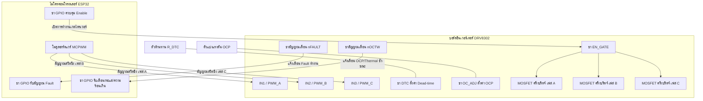
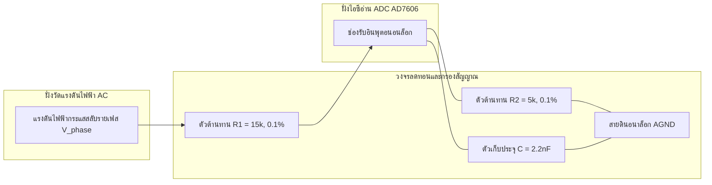
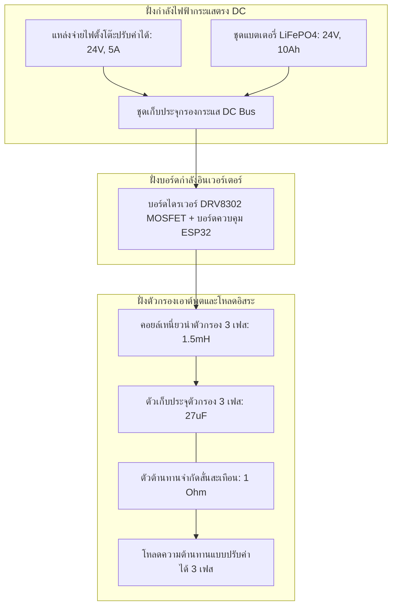
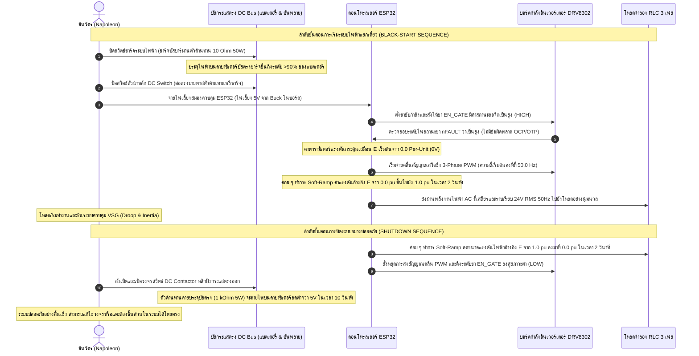

# คู่มือความปลอดภัยและการออกแบบฮาร์ดแวร์ Virtual Synchronous Generator (VSG)
## ต้นแบบอินเวอร์เตอร์ 3 เฟสควบคุมด้วย ESP32 พิกัดแรงดันต่ำปลอดภัย (24V DC, 100 VA) ในโหมดแยกเดี่ยว (Pure Islanded Mode)

---

### บทนำ (Introduction)
ยินดีต้อนรับ ชินวัตร (Napoleon)! ในฐานะนักศึกษาภาควิชาวิศวกรรมไฟฟ้า ชั้นปีที่ 3 ที่กำลังเริ่มทำโครงงานออกแบบเครื่องกำเนิดไฟฟ้าซิงโครนัสเสมือน หรือ **Virtual Synchronous Generator (VSG)** ควบคุมด้วยไมโครคอนโทรลเลอร์ ESP32 นี้

ระบบ VSG ทำหน้าที่เลียนแบบลักษณะทางกลและพลวัตทางแม่เหล็กไฟฟ้าของเครื่องกลไฟฟ้าซิงโครนัสแบบดั้งเดิม เช่น แรงเฉื่อยเสมือน (Virtual Inertia) และการหน่วงเสมือน (Virtual Damping) ผ่านการควบคุมอินเวอร์เตอร์แหล่งจ่ายแรงดัน 3 เฟส (Voltage Source Inverter: VSI) โดยต้นแบบชิ้นนี้ได้รับการออกแบบมาเฉพาะสำหรับ **โหมดแยกเดี่ยวโดยสมบูรณ์ (Pure Islanded / Grid-Forming / Standalone Mode)** ในโหมดนี้ VSG จะไม่เชื่อมต่อหรือซิงโครไนซ์เข้ากับระบบกริดหลัก แต่จะทำหน้าที่เป็น "แหล่งจ่ายแรงดันอ้างอิงหลัก" ที่สร้างและควบคุมความถี่ระดับท้องถิ่น ($\omega$) และแอมพลิจูดของแรงดันไฟฟ้า ($E$) ให้แก่โหลดจำลอง 3 เฟสแบบแยกเดี่ยวโดยตรง ซึ่งจะทำให้สามารถตัดความซับซ้อนและงบประมาณของอุปกรณ์ฝั่งประสานกริดออกไปได้ทั้งหมด (เช่น วงจรล็อกเฟส PLL และรีเลย์กริดไฟฟ้า) ช่วยให้การทดลองในแล็บปลอดภัยสูงสุดและประหยัดงบประมาณ

แม้ว่าระบบอินเวอร์เตอร์ VSG ในอุตสาหกรรมจะทำงานที่แรงดันไฟฟ้าสูง (เช่น 400V AC หรือสูงกว่า) และมีพิกัดกำลังไฟฟ้าสูง (เช่น 10 kVA ถึงระดับเมกะวัตต์) แต่การสร้างต้นแบบจริงในห้องปฏิบัติการที่พิกัดดังกล่าวมีความเสี่ยงอันตรายถึงชีวิตและค่าใช้จ่ายสูงมาก คู่มือเล่มนี้จึงได้รับการเรียบเรียงขึ้นเพื่อเป็นพิมพ์เขียวทางวิศวกรรมที่มีความถูกต้องทางคณิตศาสตร์และมีความปลอดภัยสูง โดยการสเกลลดขนาดพารามิเตอร์ลงมาเป็น **ต้นแบบแรงดันต่ำ (24V DC, 100 VA)** โดยที่ยังสามารถคง **พฤติกรรมทางพลวัตในหน่วย Per-Unit (pu) ให้เหมือนกับระบบขนาดใหญ่ 10 kVA ทุกประการ**

เอกสารฉบับนี้จะทำหน้าที่เป็นคู่มืออ้างอิงของคุณสำหรับการคำนวณสเกลพารามิเตอร์ลูปควบคุม การคัดสรรอุปกรณ์ไฟฟ้า วงจรอ่านค่าสัญญาณไฟฟ้า การจัดเตรียมโต๊ะทดลองแล็บ และมาตรการความปลอดภัยทางไฟฟ้าสำหรับการทำ Black-Start

---

## 1. โมดูลกำลังไฟฟ้าอินเวอร์เตอร์ 3 เฟสพิกัดแรงดันต่ำ (Power Stage Module)

ในการสร้างอินเวอร์เตอร์ฝั่งกำลังไฟฟ้า เราหลีกเลี่ยงการสร้างบอร์ด MOSFET H-bridge แบบลอยสายขึ้นมาเอง เนื่องจากสวิตชิ่งความถี่สูง (>20 kHz) ต้องการวงจรขับเกต (Gate Drive) ที่มีความแม่นยำสูง มีช่วงเวลาขอบขาขึ้นและขาลงที่เร็วมาก และต้องทนทานต่อสัญญาณรบกวนแม่เหล็กไฟฟ้า แรงดันกระชากชั่วขณะ และการลัดวงจร ดังนั้น เราจึงเลือกใช้ **บอร์ดกำลังมอเตอร์ 3 เฟสสำเร็จรูป** ที่ขับเคลื่อนด้วยชิปเกตไดรเวอร์ไอซี **Texas Instruments DRV8302** หรือ **DRV8301**

### ทำไมต้องเลือกใช้ TI DRV8302 / DRV8301?
ชิป DRV8302 เป็นเกตไดรเวอร์แบบบูรณาการ 3 เฟสประสิทธิภาพสูง สามารถขับ MOSFET แบบ N-channel ภายนอกได้สูงสุดที่แรงดัน 60V และจ่ายกระแสขับเกตสูงสุดที่ 1.7A (Source) และ 2.3A (Sink) ชิปนี้เหมาะสมกับต้นแบบ 24V DC ของคุณอย่างมากเนื่องจากคุณสมบัติต่อไปนี้:
1. **มีวงจรแปลงแรงดัน Buck Regulator ในตัว:** สามารถแปลงแรงดันไฟฟ้าจาก DC Bus หลัก (24V) ลงมาเป็นแรงดัน 5V ที่กระแสสูงสุด 1.5A เพื่อจ่ายไฟเลี้ยงให้กับบอร์ด ESP32 และอุปกรณ์เซ็นเซอร์วัดสัญญาณได้โดยตรงโดยไม่ต้องมีแหล่งจ่ายไฟเสริมแยกภายนอก
2. **มีวงจรอ่านกระแส Shunt Amplifiers ในตัว:** มีตัวขยายสัญญาณกระแส (Low-noise shunt amps) ประสิทธิภาพสูง 2 ชุด สามารถปรับ Gain การขยายสัญญาณได้ 4 ระดับ (10, 20, 40 หรือ 80 V/V) และมีระบบปรับเทียบศูนย์เพื่อใช้วัดกระแสเอาต์พุตแต่ละเฟสได้อย่างแม่นยำ
3. **ระบบป้องกันระดับฮาร์ดแวร์ที่ครบถ้วน (Hardware Protection Suite):**
   - **ระบบป้องกันกระแสเกิน (Overcurrent Protection: OCP):** ตรวจจับแรงดันตกคร่อม Drain-to-Source ($V_{DS}$) ของ MOSFET แต่ละตัวขณะทำงาน หากเกิดกระแสเกินจนแรงดันตกคร่อมสูงเกินเกณฑ์ที่ตั้งไว้ผ่านขา `OC_ADJ` ชิปจะสั่งปิดเกตของ MOSFET ทุกตัวทันทีภายในเวลาไมโครวินาทีเพื่อป้องกันอินเวอร์เตอร์ระเบิด
   - **ระบบป้องกันอุณหภูมิเกิน (Overtemperature Protection: OTP):** สั่งปิดไอซีทันทีหากอุณหภูมิภายในตัวไอซีสูงเกิน 150°C
   - **ระบบล็อคแรงดันต่ำ (Undervoltage Lockout: UVLO):** ป้องกันไม่ให้อินเวอร์เตอร์สวิตช์ทำงานหากแรงดัน DC Bus ต่ำเกินไป เพื่อป้องกันไม่ให้เกิดความร้อนสูงสะสมที่รอยต่อ MOSFET ขณะเปลี่ยนผ่านเฟส
   - **ระบบป้องกันการลัดวงจรกิ่งเดียวกัน (Shoot-Through Prevention):** แทรกเวลาหน่วงระหว่างการสลับสวิตช์ตัวบนและตัวล่าง (Dead-time) โดยอัตโนมัติ (กำหนดค่าผ่านตัวต้านทานที่ขา `DTC`) เพื่อรับประกันว่าสวิตช์ตัวบนและตัวล่างในกิ่งเฟสเดียวกันจะไม่เปิดพร้อมกันอย่างเด็ดขาด
4. **โหมดอินพุต PWM ที่ยืดหยุ่น:** รองรับทั้งโหมด 6-PWM (การควบคุม MOSFET อิสระ 6 ตัว) และโหมด 3-PWM (ไมโครคอนโทรลเลอร์สั่งสัญญาณ PWM เพียง 3 เส้น และชิปจะสร้างสัญญาณกลับเฟส Complementary และแทรก Dead-time ให้โดยอัตโนมัติ)

### รูปแบบการต่อสายบอร์ด ESP32 กับบอร์ด DRV8302
ไมโครคอนโทรลเลอร์ ESP32 มีโมดูลฮาร์ดแวร์พิเศษเฉพาะตัวที่เรียกว่า **MCPWM (Motor Control Pulse Width Modulation)** ซึ่งออกแบบมาสำหรับการสร้างคลื่นสัญญาณสวิตชิ่ง 3 เฟสแบบ Complementary โดยเฉพาะ

เพื่อความปลอดภัยสูงสุดในการทดลอง แนะนำให้ต่อสายใช้งานใน **โหมด 3-PWM** เนื่องจากชิปเกตไดรเวอร์จะช่วยล็อกและสร้างระยะห่างการสลับสวิตช์ (Dead-time) ให้ที่ระดับฮาร์ดแวร์ ป้องกันกรณีที่ซอฟต์แวร์ทำงานผิดพลาดหรือค้างแล้วสั่งสวิตช์ชนกัน

---

## 2. การคำนวณขนาดทางคณิตศาสตร์และการแปลงอัตราส่วนพารามิเตอร์ (10 kVA สู่ 100 VA)

เพื่อให้การทดสอบบนโต๊ะทดลองแรงดันต่ำมีความเที่ยงตรงเทียบเท่าระบบใหญ่ในโรงไฟฟ้า เราต้องทำการแปลงขนาดพารามิเตอร์ของระบบควบคุม (แรงเฉื่อยเสมือน $J$, ค่าหน่วงสั่นสะเทือน $D_p$, ค่าควบคุมกำลังรีแอกทีฟ $K_q$) และ Gain ของลูปควบคุมกระแส/แรงดันภายใน ให้สอดคล้องกันตามความสัมพันธ์ทางคณิตศาสตร์ เพื่อส่งผลให้ **การตอบสนองพลวัตในหน่วย Per-Unit (pu) ของต้นแบบขนาด 100 VA ตรงกับระบบจริงพิกัด 10 kVA ทุกประการ**

### 2.1 การกำหนดค่าฐานของระบบ (Base Values Definition)
กำหนดให้ดัชนี $H$ คือระบบกำลังไฟฟ้าสูง (High-Power) และดัชนี $L$ คือต้นแบบแรงดันต่ำ (Low-Power) เรากำหนดค่าฐานของระบบโดยใช้พิกัดแรงดันไฟฟ้าไลน์ทูไลน์ RMS ($V_{base}$) และพิกัดกำลังปรากฏ 3 เฟส ($S_{base}$) ภายใต้ความถี่โครงข่ายพิกัด $f_0 = 50\text{ Hz}$ ($\omega_0 = 2\pi f_0 \approx 314.16\text{ rad/s}$) ดังนี้:

| พารามิเตอร์ระบบฐาน | ค่าฐานระบบกำลังสูง (H) | ค่าฐานต้นแบบแรงดันต่ำ (L) | อัตราส่วนการแปลง ($L/H$) |
| :--- | :--- | :--- | :--- |
| **พิกัดกำลังปรากฏ ($S_{base}$)** | $10,000\text{ VA}$ | $100\text{ VA}$ | $0.01$ |
| **แรงดันไลน์ทูไลน์ RMS ($V_{base}$)** | $400\text{ V}$ | $24\text{ V}$ | $0.06$ |
| **แรงดันเฟสเทียบกับนิวทรัล RMS ($V_{base\_ph}$)**| $\frac{400}{\sqrt{3}} \approx 230.94\text{ V}$ | $\frac{24}{\sqrt{3}} \approx 13.86\text{ V}$ | $0.06$ |
| **พิกัดกระแสระบบฐาน ($I_{base}$)** | $\frac{S_{base,H}}{\sqrt{3} V_{base,H}} \approx 14.43\text{ A}$ | $\frac{S_{base,L}}{\sqrt{3} V_{base,L}} \approx 2.41\text{ A}$ | $0.1667$ |
| **ความต้านทานระบบฐาน ($Z_{base}$)** | $\frac{V_{base,H}^2}{S_{base,H}} = 16\ \Omega$ | $\frac{V_{base,L}^2}{S_{base,L}} = 5.76\ \Omega$ | $0.36$ |
| **ความเหนี่ยวนำระบบฐาน ($L_{base}$)** | $\frac{Z_{base,H}}{\omega_0} \approx 50.93\text{ mH}$ | $\frac{Z_{base,L}}{\omega_0} \approx 18.34\text{ mH}$ | $0.36$ |
| **ความจุไฟฟ้าระบบฐาน ($C_{base}$)** | $\frac{1}{\omega_0 Z_{base,H}} \approx 198.94\ \mu\text{F}$ | $\frac{1}{\omega_0 Z_{base,L}} \approx 552.62\ \mu\text{F}$ | $2.778$ |

---

### 2.2 การแปลงขนาดสมการสวิงลูปกำลังจริง (Active Power Loop Sizing)
สมการสวิงทางกายภาพที่ควบคุมความถี่เสมือนของโรเตอร์ $\omega$ ในระบบ VSG คือ:
$$J \omega_0 \frac{d\omega}{dt} = P_{m} - P_{e} - D_p (\omega - \omega_0)$$

โดยที่:
- $J$ คือโมเมนต์ความเฉื่อยเสมือน ($\text{kg}\cdot\text{m}^2$)
- $D_p$ คือค่าสัมประสิทธิ์การหน่วงเสมือน ($\text{W}\cdot\text{s/rad}$)
- $P_m, P_e$ คือกำลังไฟฟ้ากลและกำลังไฟฟ้าออกจริงเสมือน ($\text{W}$)

เมื่อทำการจัดรูปสมการเป็นหน่วย Per-Unit โดยการหารกำลังไฟฟ้าด้วยกำลังฐาน $S_{base}$ และหารความเร็วเชิงมุมด้วยความเร็วพิกัด $\omega_0$ ($\omega_{pu} = \omega/\omega_0$):
$$\frac{J \omega_0^2}{S_{base}} \frac{d\omega_{pu}}{dt} = \frac{P_m}{S_{base}} - \frac{P_e}{S_{base}} - \frac{D_p \omega_0}{S_{base}} (\omega_{pu} - 1)$$

เรากำหนด **ค่าคงที่ความเฉื่อยในหน่วย Per-Unit $H$** (หน่วยเป็น วินาที) และ **ค่าสัมประสิทธิ์การหน่วงในหน่วย Per-Unit $D_{pu}$** (ไม่มีหน่วย) ดังนี้:
$$2H = \frac{J \omega_0^2}{S_{base}} \implies H = \frac{\frac{1}{2} J \omega_0^2}{S_{base}}$$
$$D_{pu} = \frac{D_p \omega_0}{S_{base}}$$

จะได้สมการสวิงในหน่วย Per-Unit ไร้มิติ:
$$2H \frac{d\omega_{pu}}{dt} = P_{m,pu} - P_{e,pu} - D_{pu} (\omega_{pu} - 1)$$

#### พิสูจน์การสเกลลดขนาด (The Scaling Proof)
เพื่อให้พฤติกรรมความเฉื่อยเสมือนและการสั่นไหวของความถี่ในการทดลองต้นแบบพิกัดต่ำ ($L$) เหมือนกับระบบพิกัดจริงขนาดใหญ่ ($H$) ค่าพารามิเตอร์ไร้มิติในหน่วย Per-Unit ของทั้งสองระบบจะต้องมีค่าเท่ากัน:
$$H_L = H_H \quad \text{และ} \quad D_{pu,L} = D_{pu,H}$$

จากนิยามของตัวแปร $H$:
$$\frac{J_L \omega_0^2}{2 S_{base,L}} = \frac{J_H \omega_0^2}{2 S_{base,H}} \implies J_L = J_H \left( \frac{S_{base,L}}{S_{base,H}} \right)$$

และจากนิยามของตัวหน่วงความถี่ $D$:
$$\frac{D_{p,L} \omega_0}{S_{base,L}} = \frac{D_{p,H} \omega_0}{S_{base,H}} \implies D_{p,L} = D_{p,H} \left( \frac{S_{base,L}}{S_{base,H}} \right)$$

แทนค่าพิกัดกำลังไฟฟ้า ($S_{base,H} = 10,000\text{ VA}$ และ $S_{base,L} = 100\text{ VA}$):
$$J_L = 0.01 \times J_H$$
$$D_{p,L} = 0.01 \times D_{p,H}$$

**การพิสูจน์ความสอดคล้องทางพลวัต:**
เมื่อนำพารามิเตอร์ $J_L$ และ $D_{p,L}$ ที่คำนวณได้แทนกลับลงไปในสมการสวิงทางกายภาพของต้นแบบแรงดันต่ำ:
$$J_L \omega_0 \frac{d\omega_L}{dt} = P_{m,L} - P_{e,L} - D_{p,L} (\omega_L - \omega_0)$$
$$\left(0.01 J_H\right) \omega_0 \frac{d\omega_L}{dt} = P_{m,L} - P_{e,L} - \left(0.01 D_{p,H}\right) (\omega_L - \omega_0)$$

หารสมการทั้งหมดด้วยกำลังฐาน $S_{base,L} = 100\text{ VA}$ เพื่อทำเป็นหน่วย Per-Unit:
$$\frac{0.01 J_H \omega_0}{100} \frac{d\omega_L}{dt} = \frac{P_{m,L}}{S_{base,L}} - \frac{P_{e,L}}{S_{base,L}} - \frac{0.01 D_{p,H}}{100} (\omega_L - \omega_0)$$
$$\frac{J_H \omega_0}{10,000} \frac{d\omega_L}{dt} = P_{m,L,pu} - P_{e,L,pu} - \frac{D_{p,H}}{10,000} (\omega_L - \omega_0)$$

แทนค่ากำลังฐานของระบบใหญ่ $S_{base,H} = 10,000$ และแทนค่าความเร็วเชิงมุมในรูปหน่วย Per-Unit ($\omega_L = \omega_0 \omega_{L,pu}$):
$$\frac{J_H \omega_0^2}{S_{base,H}} \frac{d\omega_{L,pu}}{dt} = P_{m,L,pu} - P_{e,L,pu} - \frac{D_{p,H} \omega_0}{S_{base,H}} (\omega_{L,pu} - 1)$$
$$2H_H \frac{d\omega_{L,pu}}{dt} = P_{m,L,pu} - P_{e,L,pu} - D_{pu,H} (\omega_{L,pu} - 1)$$

เนื่องจากสมการเชิงอนุพันธ์หน่วย Per-Unit ที่ได้ออกมานั้นเหมือนกันทุกประการกับของระบบใหญ่ **พฤติกรรมการตอบสนองชั่วขณะของความถี่ อัตราการเปลี่ยนแปลงความถี่ (RoCoF) และระยะเวลาเข้าสู่สภาวะคงตัวจึงเหมือนกันทางคณิตศาสตร์ในหน่วย Per-Unit ทุกประการ**

---

### 2.3 การแปลงขนาดลูปกำลังรีแอกทีฟ (Voltage Droop Sizing)
สมการ Droop กำลังรีแอกทีฟทางกายภาพคือ:
$$E = E_0 - K_q (Q - Q_0)$$

โดยที่:
- $E$ คือแรงเคลื่อนไฟฟ้าเหนี่ยวนำเสมือน (แรงดันอ้างอิงเอาต์พุตของอินเวอร์เตอร์, $\text{V}$)
- $Q$ คือกำลังไฟฟ้าชดเชยรีแอกทีฟที่วัดได้ ($\text{VAR}$)
- $K_q$ คือค่าสัมประสิทธิ์ Droop ทางกายภาพ ($\text{V/VAR}$)

เมื่อทำการแปลงสมการเป็นหน่วย Per-Unit โดยการหาร $E$ และ $E_0$ ด้วยแรงดันฐาน $V_{base}$ และหาร $Q$ ด้วยกำลังฐาน $S_{base}$ ($Q_{pu} = Q / S_{base}$):
$$\frac{E}{V_{base}} = \frac{E_0}{V_{base}} - \frac{K_q S_{base}}{V_{base}} \left( \frac{Q - Q_0}{S_{base}} \right) \implies E_{pu} = E_{0,pu} - K_{q,pu} (Q_{pu} - Q_{0,pu})$$

โดยที่ค่าสัมประสิทธิ์ Droop หน่วย Per-Unit ไร้มิตินิยามเป็น:
$$K_{q,pu} = K_q \frac{S_{base}}{V_{base}}$$

#### พิสูจน์การสเกลลดขนาด (The Scaling Proof)
เพื่อให้พฤติกรรม Droop แรงดันไฟฟ้าอ้างอิงในหน่วย Per-Unit เหมือนกัน ($K_{q,pu,L} = K_{q,pu,H}$):
$$K_{q,L} \frac{S_{base,L}}{V_{base,L}} = K_{q,H} \frac{S_{base,H}}{V_{base,H}} \implies K_{q,L} = K_{q,H} \left( \frac{V_{base,L}}{V_{base,H}} \right) \left( \frac{S_{base,H}}{S_{base,L}} \right)$$

แทนค่าระบบฐาน ($V_{base,L} = 24\text{ V}$, $V_{base,H} = 400\text{ V}$, $S_{base,H} = 10,000\text{ VA}$, $S_{base,L} = 100\text{ VA}$):
$$K_{q,L} = K_{q,H} \times \left( \frac{24}{400} \right) \times \left( \frac{10,000}{100} \right) = K_{q,H} \times 0.06 \times 100 = 6 \times K_{q,H}$$

> [!IMPORTANT]
> เพื่อให้ได้พลวัตแรงดันไฟฟ้าตกตามกำลังรีแอกทีฟในหน่วย Per-Unit ที่เหมือนกัน **ค่า Droop ทางกายภาพของต้นแบบแรงดันต่ำ ($K_{q,L}$) จะต้องถูกปรับเพิ่มขึ้นเป็น 6 เท่าของค่าระบบใหญ่ ($K_{q,H}$)** เนื่องจากพิกัดแรงดันไฟฟ้าลดลงช้ากว่าพิกัดกำลังไฟฟ้ามาก ทำให้สัดส่วนความต้านทานฐานและกำลังไฟฟ้าเปลี่ยนไป

---

### 2.4 การสเกล Gain ของลูปควบคุมแบบอนุกรมภายใน (Inner Loop PI Scaling)
โครงสร้างการควบคุม VSG ยุคใหม่จะใช้ระบบควบคุมแบบป้อนกลับต่อเนื่องแบบอนุกรม (Cascaded Closed-Loop Control): ลูปนอกควบคุมแรงดันไฟฟ้าตัวเก็บประจุ $v_C$ และลูปในควบคุมกระแสไฟฟ้าตัวเหนี่ยวนำตัวกรอง $i_L$

#### 1. ลูปควบคุมกระแสตัวเหนี่ยวนำภายใน (Inner Current Loop PI Gains)
ตัวควบคุม PI สำหรับกระแสไฟฟ้าจะให้ผลลัพธ์เป็นแรงดันอ้างอิงขาออก:
$$v_{inv}^* = v_C + \left( K_{p,i} + \frac{K_{i,i}}{s} \right) (i_L^* - i_L)$$

โดยที่ Gain สัดส่วน $K_{p,i}$ มีหน่วยเป็น โอห์ม ($\Omega$) และ Gain ปริพันธ์ $K_{i,i}$ มีหน่วยเป็น โอห์มต่อวินาที ($\Omega/\text{s}$) เมื่อหารด้วย $V_{base}$ และแทนค่ากระแสในหน่วย Per-Unit ($i_L = i_{L,pu} I_{base}$):
$$v_{inv,pu}^* = v_{C,pu} + \left( \frac{K_{p,i}}{Z_{base}} + \frac{K_{i,i}}{Z_{base} \cdot s} \right) (i_{L,pu}^* - i_{L,pu})$$

เรานิยาม Gain ลูปกระแสไฟฟ้าในหน่วย Per-Unit เป็น:
$$K_{p,i,pu} = \frac{K_{p,i}}{Z_{base}} \quad \text{และ} \quad K_{i,i,pu} = \frac{K_{i,i}}{Z_{base}}$$

เพื่อให้คุณสมบัติของลูปกระแสไฟฟ้าในหน่วย Per-Unit เหมือนกัน เราตั้งค่า $K_{p,i,pu,L} = K_{p,i,pu,H}$ และ $K_{i,i,pu,L} = K_{i,i,pu,H}$:
$$K_{p,i,L} = K_{p,i,H} \left( \frac{Z_{base,L}}{Z_{base,H}} \right) = K_{p,i,H} \left( \frac{5.76}{16} \right) = 0.36 \times K_{p,i,H}$$
$$K_{i,i,L} = K_{i,i,H} \left( \frac{Z_{base,L}}{Z_{base,H}} \right) = 0.36 \times K_{i,i,H}$$

#### 2. ลูปควบคุมแรงดันไฟฟ้าภายนอก (Outer Voltage Loop PI Gains)
ตัวควบคุม PI สำหรับแรงดันไฟฟ้าจะให้ผลลัพธ์เป็นกระแสอ้างอิง:
$$i_L^* = i_{load} + C_f \frac{dv_C}{dt} + \left( K_{p,v} + \frac{K_{i,v}}{s} \right) (v_C^* - v_C)$$

โดยที่ Gain สัดส่วน $K_{p,v}$ มีหน่วยเป็น ซีเมนส์ ($\Omega^{-1}$) และ $K_{i,v}$ มีหน่วยเป็น ซีเมนส์ต่อวินาที ($\Omega^{-1}/\text{s}$) เมื่อหารด้วย $I_{base}$ และแทนค่าแรงดันในหน่วย Per-Unit ($v_C = v_{C,pu} V_{base}$):
$$i_{L,pu}^* = i_{load,pu} + C_f Z_{base} \frac{dv_{C,pu}}{dt} + \left( K_{p,v} Z_{base} + \frac{K_{i,v} Z_{base}}{s} \right) (v_{C,pu}^* - v_{C,pu})$$

เรานิยาม Gain ลูปแรงดันไฟฟ้าในหน่วย Per-Unit เป็น:
$$K_{p,v,pu} = K_{p,v} Z_{base} \quad \text{และ} \quad K_{i,v,pu} = K_{i,v} Z_{base}$$

เพื่อให้พลวัตลูปแรงดันไฟฟ้าในหน่วย Per-Unit เหมือนกัน เราตั้งค่า $K_{p,v,pu,L} = K_{p,v,pu,H}$ และ $K_{i,v,pu,L} = K_{i,v,pu,H}$:
$$K_{p,v,L} = K_{p,v,H} \left( \frac{Z_{base,H}}{Z_{base,L}} \right) = K_{p,v,H} \left( \frac{16}{5.76} \right) \approx 2.778 \times K_{p,v,H}$$
$$K_{i,v,L} = K_{i,v,H} \left( \frac{Z_{base,H}}{Z_{base,L}} \right) = K_{i,v,H} \left( \frac{16}{5.76} \right) \approx 2.778 \times K_{i,v,H}$$

---

### 2.5 การสเกลอุปกรณ์กรองเอาต์พุต AC (AC Filter Component Scaling)
เพื่อให้คุณสมบัติการส่งผ่านกำลังและฟิลเตอร์คลื่นสวิตชิ่งของทั้งสองระบบเหมือนกัน อุปกรณ์กรองทางกายภาพ $L_f$ และ $C_f$ จะต้องมีค่าในหน่วย Per-Unit เท่ากัน กำหนดให้ค่าพารามิเตอร์การออกแบบฟิลเตอร์ทั่วไปคือ: $L_{f,pu} = 0.08\text{ pu}$ และ $C_{f,pu} = 0.05\text{ pu}$

#### 1. การคำนวณความเหนี่ยวนำตัวกรอง ($L_f$):
$$L_{f,L} = L_{f,pu} \times L_{base,L} = 0.08 \times 18.337\text{ mH} \approx 1.47\text{ mH}$$
*(เมื่อเปรียบเทียบกับขดลวดตัวเหนี่ยวนำของระบบใหญ่: $L_{f,H} = 0.08 \times 50.93\text{ mH} \approx 4.07\text{ mH}$)*

#### 2. การคำนวณความจุไฟฟ้าตัวกรอง ($C_f$):
$$C_{f,L} = C_{f,pu} \times C_{base,L} = 0.05 \times 552.62\ \mu\text{F} \approx 27.63\ \mu\text{F}$$
*(เมื่อเปรียบเทียบกับตัวเก็บประจุของระบบใหญ่: $C_{f,H} = 0.05 \times 198.94\ \mu\text{F} \approx 9.95\ \mu\text{F}$)*

---

## 3. ระบบวัดและประมวลผลสัญญาณที่รองรับ ESP32 (Measurement & Acquisition System)

ในการประมวลผลระบบควบคุมความเฉื่อยเสมือนและลูปควบคุมกระแส/แรงดันไฟฟ้าภายในอย่างแม่นยำ ESP32 จะต้องวัดแรงดันเอาต์พุต 3 เฟส ($v_a, v_b, v_c$), แรงดัน DC Bus ($V_{dc}$), และกระแสเฟสเอาต์พุต 3 เฟส ($i_a, i_b, i_c$)

แม้ว่า ESP32 จะมีโมดูลอ่านค่าสัญญาณอนาล็อก (ADC) แบบ 12 บิตในตัว (ADC1 และ ADC2) แต่ **โมดูลภายในเหล่านี้ไม่เหมาะสมอย่างยิ่งในการนำมาใช้ควบคุมงานพาวเวอร์อิเล็กทรอนิกส์** ด้วยเหตุผลดังนี้:
1. **ความไม่เชิงเส้นสูง (Severe Non-linearity):** ช่วงแรงดันที่อ่านได้จริงจะเบี่ยงเบนอย่างรุนแรง โดยเฉพาะช่วงต่ำกว่า 0.1V และช่วงสูงกว่า 3.1V ทำให้เกิดความเพี้ยนสูง
2. **การสุ่มอ่านแบบลำดับ (Sequential Sampling):** ESP32 ไม่สามารถสุ่มอ่านช่องสัญญาณหลาย ๆ ช่องพร้อมกันได้ การสุ่มอ่านสัญญาณแบบทีละช่องจะทำให้เกิดความล่าช้าของเวลา (Time delay) ระหว่างรูปคลื่นแรงดันและกระแส ซึ่งจะสร้างความเพี้ยนทางมุมเฟสเทียม (Parasitic phase shift) ทำให้คำนวณกำลังไฟฟ้าจริงและกำลังไฟฟ้ารีแอกทีฟเพี้ยนไปทั้งหมด
3. **รับได้เฉพาะแรงดันบวก (Unipolar):** พอร์ตของ ESP32 รับแรงดันได้เฉพาะย่าน 0V ถึง 3.3V แต่สัญญาณไฟ AC เอาต์พุตเป็นสัญญาณสองขั้ว (Bipolar) ทำให้ต้องใช้วงจรยกระดับแรงดันเพิ่ม (DC bias circuit) ซึ่งจะเพิ่มความร้อน สัญญาณรบกวน และค่าแรงดันเยื้อง (Offset drift)

### อุปกรณ์แนะนำเสริมประสิทธิภาพ: โมดูลแปลงสัญญาณ AD7606
เพื่อแก้ปัญหาดังกล่าวทั้งหมดอย่างยั่งยืนและรับประกันความปลอดภัยของอัลกอริทึม แนะนำให้เชื่อมต่อไมโครคอนโทรลเลอร์เข้ากับบอร์ดแปลงสัญญาณภายนอก **AD7606 ชนิด 8 ช่องสัญญาณความละเอียด 16 บิต (Simultaneous-Sampling ADC Module)**

*   **รหัสพาร์ทชิ้นส่วน:** AD7606BSTZ (หรือบอร์ดโมดูลพัฒนา AD7606 Breakout)
*   **คุณลักษณะเด่น:** ความละเอียดในการแปลง 16 บิตเต็ม สุ่มอ่านพร้อมกันทุกช่องด้วยอัตราความเร็วสูงสุด 200 kSPS และรองรับการรับสัญญาณสองขั้วจริง ($\pm5\text{V}$ หรือ $\pm10\text{V}$ กำหนดสถานะผ่านระดับขา `RANGE`)
*   **อินเทอร์เฟซ:** เชื่อมต่อกับ ESP32 ทางพอร์ตสื่อสารความเร็วสูง SPI
*   **ข้อดีด้านความปลอดภัย:** การรับสัญญาณสองขั้วจริงทำให้ Napoleon ไม่ต้องออกแบบวงจร DC bias ช่วยขจัดปัญหาการเลื่อนมุมเฟสจากการสุ่มและเพิ่มความแม่นยำสูงสุดในการวัด

### การจัดซื้อและการออกแบบวงจรเซ็นเซอร์

#### 1. วงจรวัดกระแสไฟฟ้ารายเฟสเอาต์พุต: ACS712-05B
*   **รหัสพาร์ทชิ้นส่วน:** ACS712ELCTR-05B-T
*   **รูปแบบการตรวจวัด:** ตรวจวัดสัญญาณกระแสด้วยปรากฏการณ์เอฟเฟกต์ฮอลล์ (Hall-effect isolated linear current sensor)
*   **ย่านตรวจวัด:** $\pm5\text{A}$ (เหมาะสมอย่างยิ่งกับพิกัดกระแสระบบฐาน $I_{base,L} = 2.41\text{ A}$ และกระแสยอดคลื่นสูงสุด $2.41 \times \sqrt{2} \approx 3.4\text{ A}$ ทำให้มีระดับเผื่ออย่างพอเพียง)
*   **ความไวการขยายสัญญาณ:** $185\text{ mV/A}$, โดยมีระดับกึ่งกลางแรงดันอ้างอิงที่ $2.5\text{V}$ (เมื่อจ่ายไฟเลี้ยง 5V)
*   **ประโยชน์ด้านความปลอดภัย:** การใช้ผลฮอลล์ช่วยแยกวงจรไฟฟ้ากำลังและวงจรควบคุมอิเล็กทรอนิกส์ขาดจากกันโดยเด็ดขาด (Galvanic isolation ทนได้ถึง $2.1\text{ kV RMS}$) ลดโอกาสแรงดันไฟสูงรั่วไหลเข้าพอร์ตประมวลผล

#### 2. วงจรวัดแรงดันไฟฟ้าเอาต์พุต: วงจรแบ่งแรงดันแบบความแม่นยำสูง (Bipolar Resistor Divider)
เนื่องจากแรงดันไฟฟ้ากระแสสลับเอาต์พุตฝั่ง AC ถูกจำกัดความปลอดภัยลงมาที่พิกัดต่ำ $24\text{V AC RMS}$ (แรงดันยอดคลื่นสูงสุด $24 \times \sqrt{2} \approx 34\text{ V}$) เราจึงออกแบบวงจรแบ่งแรงดัน (Resistor divider) ที่มีความแม่นยำสูงเพื่อลดทอนแรงดันให้อยู่ในช่วงอินพุต $\pm10\text{V}$ ของโมดูล AD7606 ได้โดยตรงและปลอดภัย

วงจรแบ่งแรงดันมีอัตราลดทอนเท่ากับ 4 เท่า:
- $R_1$ (ตัวต้านทานต่อเข้าสายกำลังสูง) $= 15\text{ k}\Omega$, ชนิด Metal Film ความคลาดเคลื่อนต่ำมาก $0.1\%$
- $R_2$ (ตัวต้านทานคร่อมสัญญาณลงสายดินอนาล็อก AGND) $= 5\text{ k}\Omega$, ชนิด Metal Film ความคลาดเคลื่อนต่ำมาก $0.1\%$
- แรงดันสูงสุดยอดคลื่น $40\text{ V}$ จะถูกลดทอนลงมาเหลือ $40 \times \left(\frac{5}{15+5}\right) = 10\text{ V}$ พอดี
- การป้องกันคลื่นความถี่รบกวนจากการสลับสวิตชิ่ง ให้ต่อตัวเก็บประจุชนิดเซรามิกขนาดเล็ก $C_f = 2.2\text{ nF}$ ขนานคร่อมตัวต้านทาน $R_2$ เพื่อทำหน้าที่เป็นวงจรกรองสัญญาณแปลกปลอม (Anti-aliasing low-pass filter) โดยมีความถี่ตัดคูณที่:
  $$f_c = \frac{1}{2\pi (R_1 \parallel R_2) C_f} = \frac{1}{2\pi \times 3.75\text{ k}\Omega \times 2.2\text{ nF}} \approx 19.3\text{ kHz}$$

---

## 4. เครื่องมือในห้องปฏิบัติการและระบบโหลดไฟฟ้าอิสระ (Islanded/Standalone Load System)

การควบคุมการรันต้นแบบระบบไฟฟ้าขนาดเล็กแบบแยกเดี่ยว (Islanded / Grid-Forming) อย่างปลอดภัย จำเป็นต้องจัดตั้งโต๊ะปฏิบัติการให้เป็นสัดส่วน โดยอินเวอร์เตอร์จะทำหน้าที่สร้างและควบคุมแรงดัน/ความถี่ไปหล่อเลี้ยงระบบโหลด 3 เฟสในห้องแล็บโดยตรง **โดยจะไม่มีการเชื่อมต่อกับระบบกริดไฟฟ้าบ้านของการไฟฟ้า** ซึ่งช่วยตัดความเสี่ยงไฟฟ้าลัดวงจรขนาดใหญ่ลงไปได้ และประหยัดงบประมาณการจัดหาเครื่องมือทดสอบไปได้อย่างมาก

แผนภาพด้านล่างจำลองการจัดโต๊ะปฏิบัติการและชุดต่อสายฮาร์ดแวร์จริงของคุณ:

### การจัดเตรียมเครื่องมือวัดและความปลอดภัยที่สำคัญ

#### 1. แหล่งจ่ายไฟกระแสตรงและชุดแบตเตอรี่ LiFePO4 สำรอง
- **บทบาทและข้อจำกัด:** แหล่งจ่ายไฟกระแสตรงตั้งโต๊ะในแล็บ (0-60V, 5A) ทำหน้าที่จ่ายกำลังงานหลักทางฝั่ง DC ทว่าการรัน VSG ที่ทำหน้าที่เลียนแบบความเฉื่อย (Inertia) จะส่งผลให้เกิดจังหวะกำลังไหลย้อนกลับทิศชั่วขณะ (Transient regenerative power) ในระหว่างสภาวะเปลี่ยนผ่านของโหลด 3 เฟส เนื่องจากแหล่งจ่ายไฟตั้งโต๊ะทั่วไปจ่ายไฟได้ทิศทางเดียว (Non-regenerative) แรงดันย้อนกลับนี้จะดันระดับแรงดัน DC Bus ให้กระชากสูงขึ้นทันทีจนไอซีตัดการทำงานหรือส่งผลให้ MOSFET และตัวเก็บประจุเสียหาย
- **ชุดแก้ปัญหากำลังย้อนกลับ:** ให้ต่อ **ชุดแบตเตอรี่ LiFePO4 (24V พิกัด 10Ah ถึง 20Ah)** ขนานเข้าที่บัสกระแสตรง DC Bus เสมอ เพื่อทำหน้าที่เป็น "อ่างเก็บแรงดันไฟฟ้าเสมือน" คอยซับแรงดันไฟฟ้าส่วนเกินที่สะสมย้อนกลับและรักษาระดับบัสตรงให้นิ่งปลอดภัย ซึ่งเทียบเท่าการมีมวลหมุนทางฟิสิกส์คอยสะสมและหน่วงระดับของความเฉื่อยในกังหันโรงไฟฟ้าจริง

#### 2. ส่วนประกอบวงจรกรอง 3 เฟส (Filter Elements)
- **คอยล์เหนี่ยวนำ ($L_f$):** ขนาด $1.5\text{ mH}$, ทนกระแสสวิตชิ่งต่อเนื่องได้ $5\text{A}$ โดยแกนพันลวดต้องใช้ **แกนเหล็กผง (Iron Powder)** หรือแกนพันชนิด **Sendust** เท่านั้น **ห้ามใช้คอยล์เหนี่ยวนำแกนเฟอร์ไรต์ (Ferrite)** ในวงจรกรองเอาต์พุตกำลังเด็ดขาด เนื่องจากแกนเฟอร์ไรต์จะมีพฤติกรรมอิ่มตัวแบบฉับพลัน (Abrupt saturation) ซึ่งอาจทำให้ค่าความเหนี่ยวนำดิ่งลงศูนย์ทันที ส่งผลให้เกิดกระแสกระชากลัดวงจรทำลายเกตไดรเวอร์และ MOSFET
- **ตัวเก็บประจุ ($C_f$):** ขนาด $27\ \mu\text{F}$, ทนแรงดันไม่ต่ำกว่า $100\text{V AC}$ โดยเลือกใช้คาปาซิเตอร์ชนิด **โพลีโพรพิลีนฟิล์ม (Polypropylene film)** เกรดคุณภาพสูงสำหรับไฟ AC (เช่น Kemet C4G) เท่านั้น **ห้ามใช้ตัวเก็บประจุชนิดเซรามิก (MLCC) หรือตัวเก็บประจุชนิดอิเล็กโทรไลต์** เนื่องจากเซรามิกจะสูญเสียความสามารถในการจุประจุอย่างมากเมื่อเจอระดับแรงดันใช้งานกระทำ และอิเล็กโทรไลต์ไม่รองรับกระแสริปเปิลไฟฟ้ากระแสสลับความถี่สูง
- **ตัวต้านทานจำกัดสั่นสะเทือน ($R_d$):** ขนาด $1\ \Omega$, พิกัดทนความร้อนสูง $25\text{W}$ ชนิดระบายความร้อนด้วยตัวถังอลูมิเนียม เพื่อใช้ต่ออนุกรมอนุกรมกับตัวเก็บประจุฟิลเตอร์เพื่อช่วยดูดซับแรงสั่นพ้องในย่านความถี่สวิตชิ่ง

#### 3. โหลดจำลอง 3 เฟสแบบอิสระ (Rheostat Bank)
- ระบบโหลดไฟฟ้าจำลองสร้างจากตัวต้านทานปรับค่าได้ชนิดเลื่อนสไลด์กำลังสูง 3 ตัว (เช่น ขนาด $0-100\ \Omega$, ทนความร้อน $200\text{W}$) ต่อเชื่อมเข้าด้วยกันในโครงสร้างแบบสตาร์ (Balanced Y-configuration)
- ที่ระดับแรงดันเฟสปกติ $13.86\text{ V RMS}$ ($24\text{ V}$ ไลน์ทูไลน์) การตั้งโหลดไปที่ระดับประมาณ $10\ \Omega$ ต่อเฟส จะดึงกระแส RMS เท่ากับ $1.39\text{ A}$ (หรือกระแสยอดคลื่น $2.41\text{ A}$) และบริโภคกำลังไฟฟ้าจริงรวมเท่ากับ $57.6\text{ W}$ ซึ่งเป็นพิกัดโหลดที่ปลอดภัยและเหมาะสมที่สุดภายใต้พิกัดความปลอดภัยรวม 100 VA ของคุณ

---

## 5. รายการซื้อชิ้นส่วนและวัสดุอุปกรณ์ (Bill of Materials)

ชิ้นส่วนทั้งหมดนี้ได้รับการเลือกสรรมาให้ตรงตามพารามิเตอร์ของโครงงาน และมาตรฐานความปลอดภัยสำหรับการสร้างต้นแบบจริงขนาดเล็กของคุณในโหมด Islanded โดยคุณสามารถ **ตัดชิ้นส่วนฝั่งเชื่อมกริดออกไปได้ทั้งหมด ช่วยประหยัดเงินในกระเป๋าลงไปได้มากกว่า $140.00 USD** (ประมาณ 4,900 บาท)

| ชื่ออุปกรณ์ / ชิ้นส่วน | แบรนด์ผู้ผลิต | รหัสพาร์ทชิ้นส่วน | ข้อมูลพารามิเตอร์และพิกัดเด่น | จำนวน | ราคาโดยประมาณ (USD) | หมายเหตุ |
| :--- | :--- | :--- | :--- | :--- | :--- | :--- |
| **บอร์ดกำลังมอเตอร์ 3 เฟส** | ผู้ผลิตทั่วไป / SimpleFOC | บอร์ดชีลด์ DRV8302 | รองรับ 8-60V DC, กระแสพีค 30A, มีไอซีขยายกระแส OCP | 1 | \$25.00 | อุปกรณ์หลักฝั่งกำลัง |
| **บอร์ดควบคุมหลัก** | Espressif | ESP32-WROOM-32D | ชิปไมโครคอนโทรลเลอร์ 2 แกน 240MHz, มีลูป MCPWM | 1 | \$6.00 | อุปกรณ์ควบคุมหลัก |
| **บอร์ดแปลงสัญญาณอนาล็อก** | Analog Devices | โมดูล AD7606 BSTZ | ตัวแปลง ADC 16 บิต 8 ช่องสุ่มพร้อมกัน, ย่านวัด $\pm10\text{V}$ | 1 | \$15.00 | เพื่อลด Phase Shift ในการวัด |
| **เซ็นเซอร์อ่านกระแสเฟส** | Allegro | บอร์ดชีลด์ ACS712-05B | เซ็นเซอร์กระแสใช้ผลฮอลล์ $\pm5\text{A}$ แยกกราวด์ไฟฟ้า | 3 | \$9.00 | วัดกระแสเอาต์พุต 3 เฟส |
| **คอยล์ตัวเหนี่ยวนำกรองกระแส**| Wurth Elektronik | 74437529203 (หรือพันมือ) | ขนาด $1.5\text{ mH}$, กระแสทนทานอิ่มตัว $5\text{A}$, แกน Sendust | 3 | \$24.00 | คอยล์ตัวกรอง LC ($L_f$) |
| **คาปาซิเตอร์กรองแรงดัน** | Kemet | C4GAFUD5150AA1J | ขนาด $15\ \mu\text{F} \times 2 = 30\ \mu\text{F}$, ทนไฟ AC 250V ชนิดฟิล์ม | 6 | \$18.00 | ตัวเก็บประจุตัวกรอง LC ($C_f$) |
| **ตัวต้านทานจำกัดสั่นสะเทือน** | Arcol | HS25 1R F | ขนาด $1\ \Omega$, พิกัดทนความร้อนสูง $25\text{W}$ ตัวถังอลูมิเนียม | 3 | \$7.50 | ต่ออนุกรมขนานกับตัวกรอง ($R_d$) |
| **ตัวต้านทานวงจรวัดแรงดัน** | Vishay | MBA02040C1502FCT00 | ขนาด $15\text{ k}\Omega$, เกรดโลหะฟิล์มคลาดเคลื่อนต่ำ $0.1\%$ | 10 | \$5.00 | วงจรแบ่งแรงดันวัดค่า ($R_1$) |
| **ตัวต้านทานวงจรวัดแรงดัน** | Vishay | MBA02040C5001FCT00 | ขนาด $5\text{ k}\Omega$, เกรดโลหะฟิล์มคลาดเคลื่อนต่ำ $0.1\%$ | 10 | \$5.00 | วงจรแบ่งแรงดันวัดค่า ($R_2$) |
| **คาปาซิเตอร์ป้องกันความเพี้ยน**| Kemet | C0805C222K5RACTU | ขนาด $2.2\text{ nF}$, ทนแรงดัน $50\text{V}$, เกรด C0G เซรามิก | 10 | \$2.00 | ตัวกรองคลื่นรบกวนก่อน ADC ($C_{aaf}$) |
| **ชุดแบตเตอรี่บัสกระแสตรง** | Miady | แบตเตอรี่ 24V 16Ah | แบตเตอรี่ LiFePO4 ขนาด 24V (8S) พร้อมระบบควบคุม BMS | 1 | \$80.00 | บัฟเฟอร์บัส DC ป้องกันไฟย้อน |
| **แหล่งจ่ายไฟกระแสตรงแล็บ** | Korad | KA6005D | แหล่งจ่ายตั้งโต๊ะจ่ายไฟคงที่ 0-60V, 0-5A ปรับละเอียดได้ | 1 | \$120.00 | จ่ายไฟระบบกระแสตรงหลัก |
| **โหลดจำลอง 3 เฟส** | Uxcell | โหลดสไลด์ Rheostat | ตัวต้านทานชนิดแกนลวดเลื่อนปรับค่าช่วง 0-100 โอห์ม 200W | 3 | \$60.00 | โหลดทดสอบของอินเวอร์เตอร์ |
| **ตัวต้านทานชาร์จไฟบัสตรง** | Ohmite | HS50 10R F | ขนาด $10\ \Omega$, พิกัดกำลังไฟฟ้าทนความร้อนสูง $50\text{W}$ | 1 | \$4.00 | วงจร Pre-charge บัสตรง |
| **หม้อแปลงปรับค่าแรงดัน Variac**| - | - | 0-250V AC Variac (ชุดทดสอบเชื่อมกริด) | **0** | \$0.00 | **ไม่ต้องใช้** (ประหยัด \$95.00) |
| **หม้อแปลงแยกขดไฟฟ้า** | - | - | 230V ไป 24V AC Isolation Transformer | **0** | \$0.00 | **ไม่ต้องใช้** (ประหยัด \$45.00) |

---

## 6. ขั้นตอนปฏิบัติการความปลอดภัยและการเดินลายกราวด์

### 6.1 มาตรการป้องกันการลัดวงจรกิ่งเฟสเดียวกันด้วยการกำหนด Dead-Time
สภาวะ **Shoot-through** เป็นความเสียหายที่รุนแรงและเกิดบ่อยที่สุดในโครงงานกำลังไฟฟ้า เกิดจากการที่สวิตช์ MOSFET ทั้งตัวบนและตัวล่างในกิ่งเฟสเดียวกันทำงานเปิดขึ้นมาพร้อมกัน ทำให้เกิดทางเดินไฟฟ้าลัดวงจรขั้วแบตเตอรี่กระแสตรงลงกราวด์ ส่งผลให้กระแสลัดวงจรไหลพุ่งขึ้นหลายร้อยแอมป์ในพริบตา ทำลายอุปกรณ์สวิตช์ MOSFET และชิปไดรเวอร์ให้ระเบิดเสียหายทันที

ในการแก้ไข เราจำเป็นต้องกำหนดค่าเวลาเปลี่ยนผ่านสลับสวิตช์เว้นระยะ หรือ **Dead-time ($t_{dead}$)** ผ่านขา `DTC` ของชิปเกตไดรเวอร์

#### วิธีคำนวณตั้งค่าเวลาสลับสลับสวิตช์อย่างปลอดภัย
ค่าความหน่วงที่ปลอดภัยทางวิศวกรรมไฟฟ้ากำหนดโดยความสัมพันธ์:
$$t_{dead} \ge (t_{d,off\_max} + t_{f\_max}) - (t_{d,on\_min} + t_{r\_min}) + \Delta t_{prop\_skew}$$

โดยข้อมูลคุณลักษณะของ MOSFET พาวเวอร์จริง (IRFB7437):
- $t_{d,off}$ (ช่วงเวลาปิดสวิตช์ช้าสุด) $= 88\text{ ns}$ (สูงสุด)
- $t_f$ (ช่วงเวลาแรงดันตกช้าสุด) $= 76\text{ ns}$ (สูงสุด)
- $t_{d,on}$ (ช่วงเวลาสวิตช์เริ่มเปิดไวสุด) $= 22\text{ ns}$ (ต่ำสุด)
- $t_r$ (ช่วงเวลาแรงดันขึ้นเต็มพิกัดไวสุด) $= 55\text{ ns}$ (ต่ำสุด)
- $\Delta t_{prop\_skew}$ (ค่าความคลาดเคลื่อนเวลาภายในไอซีขับเกต) $\approx 50\text{ ns}$ (สำหรับ DRV8302)

ประเมินหาค่าหน่วงเวลาขั้นต่ำที่ต้องการจริง:
$$t_{dead\_min} \ge (88\text{ ns} + 76\text{ ns}) - (22\text{ ns} + 55\text{ ns}) + 50\text{ ns} = 164\text{ ns} - 77\text{ ns} + 50\text{ ns} = 137\text{ ns}$$

เพื่อให้บอร์ดทนทานต่อสภาพความร้อนและการเสื่อมสภาพเมื่อใช้งานยาวนาน เราใช้เกณฑ์ค่าสัมประสิทธิ์เผื่อความปลอดภัยที่ $2.5$ เท่า:
$$t_{dead\_design} = 2.5 \times 137\text{ ns} \approx 342.5\text{ ns}$$

สำหรับการปรับตั้งค่าเวลา $t_{dead}$ บนชิปเกตไดรเวอร์ DRV8302 สามารถกำหนดได้ด้วยการเลือกขนาดของความต้านทาน $R_{DTC}$ ต่อลงดิน:
$$t_{dead} \approx 50\text{ ns} + 3\text{ ns} \times \left( R_{DTC} \text{ in k}\Omega \right)$$

เมื่อคำนวณหาค่าความต้านทานที่ทำให้ได้เวลาหน่วง $350\text{ ns}$:
$$350\text{ ns} = 50\text{ ns} + 3\text{ ns} \times R_{DTC} \implies R_{DTC} = 100\text{ k}\Omega$$

> [!TIP]
> ให้ตรวจสอบและบัดกรีตัวต้านทานขนาด **100 kΩ** เชื่อมคร่อมขา `DTC` ลงดินของชิป DRV8302 เพื่อกำหนดช่วงเวลาเปลี่ยนผ่านสลับสลับสวิตช์คงที่ **350 ns** ซึ่งเพียงพอในการป้องกันการระเบิดและรักษารูปร่างคลื่นสัญญาณไม่ให้เพี้ยน

---

### 6.2 ขั้นตอนลำดับการเริ่มทำงานแบบไร้กริด (Black-Start) และการปิดระบบอย่างปลอดภัย
เนื่องจากระบบทำงานในโหมดอิสระและไม่มีแรงดันกริดอ้างอิงตอนเริ่มต้น หากจ่ายกำลังงานอินเวอร์เตอร์สลับเข้าหาคาปาซิเตอร์ฟิลเตอร์กระแสสลับที่ยังว่างเปล่า ($C_f = 27.63\ \mu\text{F}$) โดยตรง จะทำให้เกิดกระแสริปเปิลและกระแสประจุพุ่งเข้าคาปาซิเตอร์อย่างรุนแรง (Capacitive inrush current) ส่งผลให้ MOSFET ระเบิดหรือระบบ OCP ตัดการทำงานทันที

เพื่อป้องกันปัญหานี้ คุณจำเป็นต้องเขียนลูปคอนโทรลให้มีฟังก์ชัน **Black-Start (Soft-Start)** โดยค่อย ๆ ปรับเพิ่มระดับของแรงดันกระตุ้นอ้างอิงภายในเสมือน ($E$) จาก $0.0\text{ pu}$ (0V) ขึ้นไปจนถึงระดับพิกัดจริง $1.0\text{ pu}$ (แรงดันเฟส RMS 13.86V, ยอดคลื่น 19.596V) อย่างช้า ๆ ในระยะเวลา **2 วินาที** ด้วยระดับความถี่คลื่นคงที่ที่ 50 Hz

ลำดับการเริ่มและปิดสวิตช์ระบบไฟฟ้าอย่างปลอดภัยมีขั้นตอนดังนี้:

---

### 6.3 แนวทางการวางสายดินและการจัดการสัญญาณรบกวนความถี่สูง (Noise Isolation)
ความถี่ในการควบคุมสลับสวิตช์ที่ $20\text{ kHz}$ ส่งผลให้เกิดการรบกวนสัญญาณแม่เหล็กไฟฟ้าค่อนข้างรุนแรงจากอัตราการเปลี่ยนแปลงแรงดันต่อวินาที ($dv/dt$) ที่สูงมาก หากเกิดการเหนี่ยวนำสัญญาณรบกวนนี้เข้าไปที่สายวัดสัญญาณวัดแรงดันและกระแส จะส่งผลให้ระบบควบคุมประมวลผลผิดพลาด และเกิดระบบดับป้องกันความปลอดภัยผิดพลาด (False trip)

เพื่อป้องกันปัญหาดังกล่าวในการทำฮาร์ดแวร์จริง ให้ยึดมาตรการดังนี้:

1. **การแยกสายดินแยกอิสระ (Star Grounding):**
   - ให้แยกจุดต่อสายดิน (Ground) ในโครงงานออกเป็น **สายดินฝั่งกำลัง (Power Ground: PGND)** และ **สายดินฝั่งวัดสัญญาณ (Analog/Signal Ground: AGND)**
   - PGND จะเป็นสายเดินขั้วลบของระบบมอเตอร์, MOSFET, Buck regulator และแบตเตอรี่ตัวเก็บประจุหลัก DC Bus ซึ่งมีกระแสสูงไหลตลอดเวลา
   - AGND จะเป็นจุดอ้างอิงแรงดันที่นิ่งสนิทสำหรับชิป ESP32, วงจรลดทอนแรงดัน และไอซีอ่าน ADC AD7606
   - **กฎเหล็ก:** ห้ามนำกราวด์สองกลุ่มนี้ต่อเชื่อมกันตามใจชอบ ให้วางวงจรแยกกันโดยเด็ดขาด และนำไปเชื่อมต่อเข้าหากันที่ **"จุดศูนย์กลางร่วมเพียงจุดเดียว" (Star point connection)** ซึ่งจุดเชื่อมที่ดีที่สุดคือ ขั้วลบของคาปาซิเตอร์ตัวใหญ่ที่สุดของ DC Bus เพื่อป้องกันกระแสลูปวิ่งวนรบกวนกันเอง

2. **การต่อตัวเก็บประจุช่วยดักกระแสกระเพื่อมชั่วขณะ (Decoupling Caps):**
   - ให้บัดกรีตัวเก็บประจุชนิดเซรามิกขนาด **0.1 μF** ต่อขนานกับตัวเก็บประจุชนิดแทนทาลัมขนาด **10 μF** คร่อมเข้ากับขาแรงดันไฟเลี้ยง VCC และ GND ของ ESP32, ชิป ADC AD7606 และบอร์ดเซ็นเซอร์ ACS712 ในระยะที่ **ใกล้ขาชิปที่สุด** (ไม่เกิน 1-2 มิลลิเมตร) เพื่อช่วยกรองสัญญาณรบกวนเฉียบพลันในระดับขาสัญญาณ

3. **การออกแบบเส้นสายส่งสัญญาณระบบบัส SPI (High-Speed SPI Layout):**
   - บอร์ดแปลง ADC AD7606 สื่อสารความเร็วสูงกับ ESP32 ทางพอร์ต SPI พยายามเชื่อมต่อและเดินสายไฟให้มีความยาว **สั้นกว่า 10 เซนติเมตร**
   - หากต้องใช้สายแพ ให้เดินสายเรียงลำดับแบบมีดินขั้นกลางสลับสัญญาณเพื่อเป็นชีลด์ป้องกันคลื่นรบกวน (เช่น GND-SCLK-GND-MISO-GND-MOSI-GND-CS)

4. **การเดินระบบสายเซ็นเซอร์วัดกระแสและแรงดัน (Sensor Wiring):**
   - การดึงสายสัญญาณจากเซ็นเซอร์ ACS712 และบอร์ดแบ่งแรงดันมาที่ขาเข้าโมดูล AD7606 ให้ใช้ **สายตีเกลียวคู่แบบมีชีลด์ถักล้อมรอบ (Shielded Twisted-Pair)** โดยปลายสายถักชีลด์ให้ต่อเชื่อมลงสายดินอนาล็อก (AGND) เฉพาะฝั่งที่ติดกับตัว ADC เพียงด้านเดียวเท่านั้น (ห้ามต่อกราวด์สองฝั่งของเปลือกชีลด์เพื่อป้องกันกราวด์ลูป)

---

### รายการตรวจสอบความปลอดภัยขั้นสุดท้ายสำหรับ Napoleon (Standalone Checklist)
ก่อนจะบิดสวิตช์เปิดการจ่ายกระแสและรันระบบทดลองแบบแยกเดี่ยวทุกครั้ง ให้ก้มหน้าตรวจความเรียบร้อยตามรายการนี้ให้ครบถ้วน:
* [ ] ได้ต่อชุดต้านทานป้องกันไฟกระชาก DC Pre-charge $10\ \Omega$ 50W อนุกรมคร่อมจุดต่อแบตเตอรี่ในจังหวะเริ่มระบบแรกแล้วใช่หรือไม่?
* [ ] บอร์ดไดรเวอร์ DRV8302 มีตัวต้านทานขนาด $100\text{ k}\Omega$ เชื่อมคร่อมขา DTC ลงกราวด์เพื่อการันตีเวลา Dead-time 350ns แล้วใช่หรือไม่?
* [ ] คอยล์เหนี่ยวนำขดลวดตัวกรองกระแสเอาต์พุตพิกัด $1.5\text{ mH}$ ใช้แกนพันลวดชนิด Sendust หรือแกนผงเหล็ก และไม่ใช่แกน Ferrite ใช่หรือไม่?
* [ ] ตัวเก็บประจุตัวกรองแรงดันเอาต์พุตทั้งหมดใช้ชนิดโพลีโพรพิลีนฟิล์มเกรด AC และไม่ได้ใช้ชนิดคาปาซิเตอร์เซรามิกหรืออิเล็กโทรไลต์ใช่หรือไม่?
* [ ] ขาเชื่อมต่อออกไปยังโหลด 3 เฟสถูกต่อแน่นสนิท มีขนาดโหลดต้านทานสมดุลและไม่เกินพิกัดกำลังปลอดภัยใช่หรือไม่?
* [ ] บอร์ดควบคุม ESP32 ถูกแฟลชโปรแกรมที่มีฟังก์ชันการ Soft-Ramp แรงดันขาออกตอนเริ่มต้น (Black-Start) แล้วใช่หรือไม่?
* [ ] บอร์ดแปลงสัญญาณ AD7606 ได้รับการจัดโครงสร้างจัมเปอร์อยู่ในโหมดเชื่อมต่อ SPI และต่อขาจ่ายแรงดันดิจิทัล `VDRIVE` เข้ากับไฟระบบ 3.3V ของ ESP32 เรียบร้อยใช่หรือไม่?
* [ ] จุดต่อประสานสายดินระบบกำลังและระบบอนาล็อกสัญญาณ Star Ground ต่อประสานกันแน่นสนิทและมีจุดรวมที่ขั้วตัวเก็บประจุบัสหลักเพียงจุดเดียวแล้วใช่หรือไม่?

*ขอให้คุณโชคดีและได้รับความรู้อย่างเต็มที่จากการทำทดลองวิจัยโครงงานชิ้นนี้อย่างปลอดภัยในโหมด Islanded ครับ ชินวัตร!*

---
*จัดทำขึ้นโดยความร่วมมือระหว่างทีมงาน AI Engineering Assistant และ นักศึกษาวิศวกรรมไฟฟ้า ชั้นปีที่ 3 มทส.*
