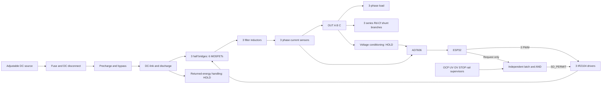

# คู่มือการต่อวงจร VSG ทั้งระบบ — ฉบับเตรียมประกอบ

วันที่ 22 ตุลาคม 2026 · Revision 0.2 · Napoleon / Chinnawat Dumklang

อัปเดต: [neutral/voltage sensing Rev A](D:/workspace/engineering/vsg-project/docs/notes/neutral_voltage_sensing_design_rev_a_2026-10-22.md) กำหนด topology และค่า signal chain แล้ว; ใช้แทนคำว่า "ยังไม่เลือกแบบ" ในสองส่วนนี้ แต่ยังมี module/power-loss/alias/CAD release gates ดู [งบทั้งชุด](D:/workspace/engineering/vsg-project/docs/notes/complete_prototype_budget_2026-10-22.md) ประกอบ

**ใช้สำหรับจัดแผง วางสาย เตรียมตรวจรับ และทำแบบต่อจริงต่อยอด ยังไม่ใช่ fabrication-ready schematic หรือใบอนุญาตเปิดภาคกำลัง** ครอบคลุม Option A: ESP32 + AD7606 + ACS712-20A + IR2104 + IRF540N ทั้งระบบ ส่วนที่ไม่มีแบบจริงระบุ HOLD พร้อมข้อมูลที่ต้องเติม ไม่สร้างหมายเลขขั้วโมดูลหรือค่าชิ้นส่วนขึ้นเอง

## 1. เริ่มอ่านตรงนี้

- **SOURCE** = ตรวจจาก source code / datasheet แล้ว แต่ยังต้องจับคู่กับบอร์ดจริง
- **PLAN** = การเชื่อมต่อเชิงหน้าที่ที่เสนอ ยังต้องตรวจ schematic/layout และชิ้นส่วนจริง
- **HOLD** = ยังต่อใช้งานส่วนนี้ไม่ได้จนปิดข้อมูลที่ระบุ
- **PASS** = ใช้ได้เฉพาะผลทดสอบจริงที่มีหลักฐาน ปัจจุบันคู่มือนี้ไม่มีรายการ hardware PASS

คำว่า GPIO คือหมายเลขสัญญาณ ESP32 ไม่ใช่ลำดับขาบนแถว header ส่วนชื่อ V1…V8 ของ ADC เป็นชื่อช่องสัญญาณ ไม่ใช่หมายเลขรูบนบอร์ด สำรวจ marking/continuity และกรอกเลขขั้วจริงในใบตรวจรับก่อนต่อทุกครั้ง

เอกสารหลักที่ต้องใช้ร่วมกัน:

| เรื่อง | ไฟล์ |
|---|---|
| Baseline ปัจจุบัน | [design_baseline.md](D:/workspace/engineering/vsg-project/docs/notes/design_baseline.md) |
| Firmware ที่อ้างอิง | [vsg_controller.ino](D:/workspace/engineering/vsg-project/hardware/esp32/vsg_controller/vsg_controller.ino) |
| Shutdown และเกณฑ์ตรวจรับ | [hardware_shutdown_and_bench_plan.md](D:/workspace/engineering/vsg-project/docs/notes/hardware_shutdown_and_bench_plan.md) |
| รายการซื้อ 45 IDs | [procurement_agent_brief_2026-10-20.md](D:/workspace/engineering/vsg-project/docs/notes/procurement_agent_brief_2026-10-20.md) |
| ใบตรวจรับสำหรับกรอก | [wiring_acceptance_sheet_2026-10-22.md](D:/workspace/engineering/vsg-project/docs/notes/wiring_acceptance_sheet_2026-10-22.md) |

Firmware SHA-256 ขณะจัดทำ: `9963A68D018B0946786B6742DA80847165B7FBDCD683DA65258D912FBB0C7B85` หาก source เปลี่ยน ต้องตรวจตาราง GPIO, channel map และ scale ใหม่

## 2. งานที่ทำระหว่างรอเงินและอุปกรณ์

| ลำดับ | งาน | ผลงานที่ควรได้ |
|---|---|---|
| 1 | สำรวจเครื่องมือแล็บและบอร์ดที่ยืม | รุ่น supply/probe/scope, power envelope, earth connection, รูปบอร์ดสองด้าน |
| 2 | พิมพ์คู่มือและตั้งชื่อสาย/จุดวัด | ป้าย PWM_A/B/C, SW_A/B/C, OUT_A/B/C, ADC_V1…V8, DC_LINK_P/N |
| 3 | ปิดแบบ voltage sensing + neutral/reference | schematic S01/S02, gain/common-mode/filter/protection และ firmware conversion ที่ตรงกัน |
| 4 | ปิดแบบ independent shutdown | schematic S03–S06/S10 พร้อม truth table, reset/ARM behavior และ threshold calculations |
| 5 | เลือก bootstrap, filter, DC-link, precharge และ thermal | component calculation sheet + MPN/ratings สำหรับ BoM |
| 6 | เตรียมการทดสอบแบบไม่มี power stage | firmware build evidence, ADC diagnostic plan และใบ calibration |
| 7 | ตรวจ layout และเครื่องมือวัด | PCB/terminal drawing, grounding drawing, test-point access |

มีบันทึกบอร์ด ESP32 ที่ยืมจากเพื่อนเมื่อ 21 ต.ค.: ชิป ESP32-D0WD-V3 rev3.1 / flash 4 MB / CP2102 แต่ยังไม่รู้ board/module revision และ header map แน่นอน ดู [inspection report](C:/Users/User/workspace/engineering/esp32-inspection/inspection-2026-10-21.md) คู่มือนี้ไม่ได้สั่ง flash หรือเปลี่ยน firmware บอร์ดที่ยืมมา

## 3. ค่าฐานที่ใช้และขอบเขต

| รายการ | ค่า |
|---|---|
| ระบบ | 3-phase islanded; ไม่มีการต่อไฟการไฟฟ้า |
| DC bus / กำลัง nominal | 40 V / 100 W รวมสามเฟส |
| แรงดัน output | 14 V peak ต่อเฟส ≈ 9.90 V RMS; line-to-line ≈ 17.15 V RMS |
| ความถี่ / PWM / control | 50 Hz / เป้าหมาย 10 kHz / 100 µs ต่อรอบ |
| Filter ต่อเฟส | Lf 1.2 mH; Cf 10 µF อนุกรม Rd 1 Ω |
| Rf ใน model | 0.05 Ω เป็นค่าความต้านทานรวมที่ model ใช้ ไม่ใช่คำสั่งซื้อ R อนุกรมเพิ่มอัตโนมัติ |
| Firmware/toolchain | Classic ESP32; Arduino-ESP32 2.0.17 |
| ADC | AD7606 ดั้งเดิม 8 ช่อง, ±10 V, serial SPI mode 2, nominal 15 MHz |

ค่าจำลองไม่ใช่พิกัดชิ้นส่วนจริง: ต้องเลือก Isat/Irms ของ L, ripple ของ C, pulse rating ของ R และ thermal assembly ส่วนการทดลองประมาณ 136 W ในอดีตเป็น overload ของฐาน 100 W

## 4. ภาพรวมระบบ



ลูกศร signal ไม่ใช่สายกำลัง ทุกวงจรต้องมี supply/return ตามหมวดต่อไป บล็อก PC/PROT/VS/SINK ยังไม่ใช่วงจรสำเร็จ

## 5. ชื่อ node และการจัดกราวด์

| ชื่อ | ความหมาย |
|---|---|
| DC_LINK_P / DC_LINK_N | ขั้วบวก/ลบของ DC-link หลัง precharge |
| SW_A / SW_B / SW_C | จุดกึ่งกลางแต่ละ half bridge เป็น switching node |
| OUT_A / OUT_B / OUT_C | AC output หลัง L และ current sensor ก่อนแยกไปโหลด/แขนง Cf |
| N_F / N_LOAD | จุดรวมดาวของ filter / load; ความสัมพันธ์ต้องกำหนดในแบบ neutral |
| AGND / DGND / DRIVER_COM | analog return / logic return / driver return ตาม layout |
| PE | protective earth ของเครื่องมือหรือ chassis ตามการออกแบบ ไม่ใช่ชื่อแทน signal ground |

**N01 — topology เลือกแล้วใน Rev A; physical release ยัง PENDING:** รวม N_F และ N_LOAD เป็น N_AC จุดเดียวสำหรับ balanced Y-load โดยไม่มี hard bond ลง DC_LINK_N/AGND/USB ground/PE วงจรวัดมีทางตัวต้านทานจึงไม่ใช่ galvanic isolation Model `phase5c_tuned.m` ใช้ neutral grounded ในระบบ phase idealized ไม่ใช่คำสั่งให้ต่อ ground ในฮาร์ดแวร์ตามนั้น

สำหรับ Option A แบบ non-isolated ต้องมี reference ร่วมที่ออกแบบระหว่าง logic/ADC/driver COM และ DC return โดยใช้ return path ที่ไม่แบก switching current ผ่านสาย ADC/USB การแยกชื่อ AGND/DGND เป็นการควบคุม routing ไม่ใช่คำสั่งให้ปล่อยกราวด์ลอยคนละศักย์ การรวมจุดใดและผ่าน copper/link ใดต้องอยู่ใน schematic/layout

ก่อนต่อ USB/scope/supply ให้บันทึกว่าขั้วใดผูก earth อยู่แล้ว ห้ามแก้ปัญหาด้วยการถอดสายดินเครื่องมือ สาย scope ground ทุกช่องอาจต่อถึงกัน การวัด SW หรือ HO ต้องใช้ differential/isolated probe ที่พิกัดเหมาะสม

## 6. ไฟเลี้ยงเสริม

| Net | ไปที่ | สิ่งที่ต้องตรวจ |
|---|---|---|
| AUX_5V_ANALOG | AD7606 AVCC/module analog input supply และ ACS712 VCC ทั้งสาม | คุณภาพ 5 V, decoupling และกระแสรวม; module regulator/jumper จริง |
| LOGIC_3V3 | AD7606 VDRIVE และ interface ที่ออกแบบสำหรับ 3.3 V | VDRIVE ไม่ใช่ AVCC; ตรวจ buffer ที่โมดูลด้วย |
| MCU supply | ช่องจ่ายไฟของ DevKit ตามคู่มือบอร์ดจริง | เลือกวิธีจ่ายเดียวหรือวงจร power-path ที่ตรวจแล้ว; ไม่ต่อ USB5V กับ bench5V ซ้อนโดยเดา |
| VDRV | IR2104 VCC ทั้งสามและ bootstrap charging path | เลือก regulated rail ในช่วง datasheet; ค่าและ sequencing ของชุดจริงยัง HOLD |
| Returns | AGND/DGND/COM | ต่อโดยอ้างอิง grounding drawing ที่ตรวจแล้ว |

ไม่จ่าย 5 V/12 V เข้าขา GPIO หรือขา 3V3 ESP32 ไม่ใช้ generic LM2596 รับตรงจาก bus nominal 40 V ที่ยังมี excursion ได้ เริ่มด้วย auxiliary supply ที่แล็บควบคุมได้และตรวจ common reference แล้ว

## 7. ESP32 ↔ AD7606: ตารางสัญญาณจาก firmware

| Wire ID | ESP32 | ทิศทาง | ชื่อที่ปลาย AD7606 | หมายเหตุ |
|---|---:|---|---|---|
| D01 | GPIO15 | MCU → ADC | CS | active LOW; header position ยังต้องยืนยัน |
| D02 | GPIO14 | MCU → ADC | RD/SCLK | SPI clock |
| D03 | GPIO12 | ADC → MCU | DOUTA | ใช้ stream ที่เริ่ม V1; ไม่สลับ DOUTB |
| D04 | GPIO2 | MCU → ADC | CONVST A และ CONVST B | firmware ใช้ trigger เดียว; ตรวจว่าบอร์ดผูกอยู่หรือจำเป็นต้องผูกเพิ่ม |
| D05 | GPIO4 | ADC → MCU | BUSY | ต้องเห็นทั้งขึ้น HIGH และกลับ LOW |
| D06 | ไม่มี GPIO RESET กำหนดไว้ | วงจร reset → ADC | RESET | ต้องมี reset หลัง power-up ที่ตรวจได้; ไม่ปล่อยลอย/ผูก LOW แล้วถือว่าครบ |
| D07 | GPIO13 | ไม่ต่อไป ADC สำหรับ data read นี้ | ไม่มี MOSI ที่ต้องใช้ | software initialize HSPI MOSI แต่ ADC interface นี้ใช้ serial output; ห้ามต่อสุ่มเข้าขา data |
| D08 | LOGIC_3V3 | Supply | VDRIVE | ตรวจไม่มี jumper ผูก 5 V และไม่มี buffer output 5 V |
| D09 | AUX_5V_ANALOG | Supply | AVCC / module supply | ตรวจ schematic รุ่นจริงก่อนเลือกขั้ว |
| D10 | Signal return | Reference | GND ของ interface | ใช้ return ตาม grounding drawing |

GPIO2, GPIO12 และ GPIO15 เป็น strapping pins ของ classic ESP32; โหลดจาก ADC/ตัวต้านทานบน module ระหว่าง reset อาจรบกวน boot โดยเฉพาะ GPIO12 กับ flash supply selection ต้องตรวจ startup waveform/board spec ก่อนยืนยัน mapping ไม่แก้ด้วยการเพิ่ม pull-up ทุกเส้น

ตั้ง ADC โดยอ้างอิง **ชื่อสัญญาณ** ใน datasheet [R1] แล้ว map ไป switch/jumper ของบอร์ดจริง:

| Setting | ต้องการ | สถานะ |
|---|---|---|
| PAR/SER/BYTE SEL + DB15/BYTE SEL | Serial: 1 และ 0 ตาม Table 8 | SOURCE; jumper implementation HOLD |
| RANGE | ±10 V | SOURCE; ตรวจ schematic/strap จริง |
| OS2:OS0 | 000, oversampling disabled | SOURCE; ตรวจ strap จริง |
| CONVST A/B | simultaneous trigger | SOURCE |
| RESET | pulse หลัง power-up ตาม timing datasheet; กลับ inactive ก่อน acquisition | HARDWARE IMPLEMENTATION HOLD |
| Reference / STBY / unused digital pins | กำหนดตาม module schematic และ datasheet | REVIEW; ไม่ปล่อย pin ที่ต้องกำหนด logic ลอย |

อย่าใช้เลข R1/R2 ของร้านหนึ่งกับทุกบอร์ด AD7606 การเปลี่ยนโหมดบางรุ่นต้อง rework resistor ไม่ใช่เพียงเปลี่ยนโค้ด

Firmware อ่าน 12 bytes = 6 signed 16-bit words จาก DOUTA ต่อรอบ ผลที่ต้องได้คือ V1…V6; V7/V8 ไม่ได้ใช้งานใน conversion function ปัจจุบัน แม้ชิปมี 8 ช่อง ต้องตรวจ CS framing และ channel identity ด้วยสัญญาณอ้างอิงทีละช่องจริง

## 8. ตาราง Analog channel และ calibration

| ADC channel | ต่อจาก | ตัวแปร firmware | Conversion ปัจจุบัน |
|---|---|---|---|
| V1 | ACS_A VOUT | ia | (Vadc − bias_A) / 0.100 V/A |
| V2 | ACS_B VOUT | ib | (Vadc − bias_B) / 0.100 V/A |
| V3 | ACS_C VOUT | ic | (Vadc − bias_C) / 0.100 V/A |
| V4 | Conditioned phase A voltage | va | Vadc ×4 |
| V5 | Conditioned phase B voltage | vb | Vadc ×4 |
| V6 | Conditioned phase C voltage | vc | Vadc ×4 |
| V7 | สำรอง; candidate สำหรับ bus sensing เท่านั้น | ไม่มี | ไม่อ่าน/ไม่ scale ใน firmware ปัจจุบัน |
| V8 | สำรอง | ไม่มี | ไม่อ่านใน firmware ปัจจุบัน |

ทุกช่องมี input reference/return ที่ต้องตรวจจาก module; AD7606 ไม่ใช่ isolated differential voltage sensor ให้กำหนด termination ของช่องว่างตามวงจรโมดูล แยกจาก power node

ADC conversion: `Vadc = signed_count × 10 / 32768` ตัวอย่าง +1 V ≈ +3277 counts และ −1 V ≈ −3277 counts เป็นค่า ideal สำหรับตรวจ sign/scale ไม่ใช่ tolerance ผ่านงานจริง

ก่อน calibration current ต้องไม่มี current ใน primary path จริง Firmware auto-zero 500 samples และตรวจ bias อยู่ภายใน 2.5 ±0.3 V; ผ่านช่วงนี้ไม่ได้พิสูจน์ sensitivity/linearity ใช้ reference current เพิ่มเพื่อตรวจ gain และ sign ทั้งสามตัว

Calibration record ต้องมี reference voltage/current, raw signed count, converted result, supply voltage, offset, gain error, polarity, เครื่องมือและ uncertainty เกณฑ์ยอมรับต้องกำหนดก่อนเริ่มทดสอบ ห้ามลดเกณฑ์หลังเห็นผล

## 9. ACS712-20A: ต่อให้วัด iL ของแต่ละเฟส

ใช้สามตัวหนึ่งตัวต่อเฟส พอร์ตกระแส IP+/IP− กับ VCC/GND/VOUT เป็นคนละหน้าที่ รูป terminal และ orientation บอร์ด clone ต้องตรวจจาก marking/วงจร ไม่อิงซ้ายขวาจากรูปประกาศขาย

```text
SW_A → L_A → ACS_A primary path → OUT_A → จุดแยกไปโหลดและแขนง Rd-Cf
                         VOUT ─────────────→ AD7606 V1
                         VCC  ─────────────→ AUX_5V_ANALOG
                         GND  ─────────────→ analog return ตามแบบ
ทำซ้ำ B → V2 และ C → V3
```

กำหนดทิศบวกจาก bridge ไปโหลด แล้วตรวจด้วยกระแสอ้างอิงที่ทราบทิศ สอดคล้องกับ IP+ → IP− ใน datasheet [R4] การวางหลัง L แต่ก่อน branch split ทำให้วัด inductor current ตาม current loop; วางหลังจุดแยกไปเฉพาะโหลดจะวัดคนละตัวแปร

P/Q ที่ใช้กระแสนี้รวมผลของแขนง filter ที่ output node ไม่ใช่กำลังโหลดเพียงอย่างเดียว ต้องระบุเมื่อเปรียบเทียบ power meter ถ้าจะวัด load power แยกต้องมีการวัด/คำนวณเพิ่มเติม

ACS712-20A sensitivity nominal 100 mV/A และ bias ประมาณครึ่ง supply; module filter capacitor มีผลต่อ bandwidth/delay ต้องตรวจว่าตรง current-loop target 1 kHz และ fault coverage; sensor นี้ไม่แทน independent OCP โดยอัตโนมัติ ไม่ต่อ VOUT เข้าขา GPIO ESP32 โดยตรง

## 10. วงจรวัดแรงดันเฟส S01 — Rev A เลือกค่าแล้ว; integration HOLD

Interface ที่ต้องออกแบบให้ได้:

```text
OUT_x และ phase reference ที่กำหนด
 → attenuation / differential หรือ isolated front end ตาม common-mode ที่เลือก
 → bandwidth/anti-alias conditioning + input protection
 → AD7606 V4/V5/V6 เทียบ AGND
```

Firmware ปัจจุบันต้องการ `Vadc = Vphase / 4` โดยไม่มี offset subtraction สำหรับแรงดัน ดังนั้น ±14 V phase จะให้ ±3.5 V ที่ ADC **เมื่อวงจร differential/reference ทำให้ความหมาย Vphase ถูกต้องแล้ว**

คอมเมนต์ใน firmware กล่าวถึง R1=15 kΩ/R2=5 kΩ แต่เป็นเพียง ideal ratio 1/4 ไม่ใช่วงจรสามเฟสที่ตรวจแล้ว: input loading, common-mode, neutral movement, resistor matching, bandwidth, protection และ reference ยังไม่ปิดแบบ **ห้ามนำ divider สองตัวต้านทานต่อ OUT_x ลง DC− เพียงเพราะอัตราส่วนตรง**

ตัวอย่าง ×0.5 ที่อธิบายในแชตก่อนหน้าเป็นคณิตศาสตร์ทั่วไป ไม่ตรงค่าคงที่ ×4 ใน source นี้ ถ้าเลือก front end gain/offset ต่างจากนี้ ต้องแก้ conversion และทดสอบก่อนใช้ closed loop

Rev A ใช้ OPA4197ID ±12 V, input40 kΩ/feedback10 kΩและอีกแขนratioเดียวกัน, precision10 kΩ0.01%รวมเป็นchains พร้อมmatched1nF ได้gain1/4; OUT_xและN_ACเข้าdiffampคนละข้าง แทนsimpledividerในคอมเมนต์เก่า มีconnectiontable/BoM/analyticalresultsแล้ว การปลดHOLDยังต้องตรวจmodule ADC, rail-loss/interface timing, alias/loop responseและCADตามrelease gatesในdesign note

## 11. DC-bus sensing S02 และ UV/OV S06 — HOLD

S02 Rev A เลือกdivider90 kΩ/10 kΩ +10nF +OPA4197ช่องที่สี่แล้ว;40 V→4 V ใช้V7เป็นcandidate แต่firmwareยังไม่อ่านและS06ยังต้องออกแบบอิสระ

S02 เป็น measurement interface แยกจาก S06 ซึ่งต้อง shutdown ได้เอง การมีช่อง ADC ว่างไม่ทำให้ protection พร้อม

- กำหนด bus maximum รวม excursion และ attenuation จากค่านั้น ไม่เลือกจาก nominal 40 V อย่างเดียว
- ตรวจกำลัง/working-voltage ของ resistor network, filter settling, fault behavior และ input clamp
- หากใช้ V7 ต้องเพิ่ม firmware read length/channel scaling/telemetry/tests; ปัจจุบัน `Vdc=40` เป็นค่าคงที่ ไม่ใช่ผลวัด
- UV/OV comparator/supervisor ต้องส่ง fault ไป latch โดยไม่รอ software และมี threshold/hysteresis ที่มาจาก operating envelope
- UV/OV ไม่ดูดพลังงานกลับ ต้องมี energy handling ในหมวด 17 เพิ่ม

## 12. ESP32 → PWM/permit/fault

| Wire ID | ต้นทาง | ปลายทาง | สถานะ/ข้อกำหนด |
|---|---|---|---|
| C01 | GPIO25 | IR2104_A IN ผ่าน interface ที่ตรวจแล้ว | PWM_A |
| C02 | GPIO26 | IR2104_B IN ผ่าน interface ที่ตรวจแล้ว | PWM_B |
| C03 | GPIO27 | IR2104_C IN ผ่าน interface ที่ตรวจแล้ว | PWM_C |
| C04 | GPIO22 | MCU_REQUEST ของ external permit circuit | ไม่ต่อข้าม latch ไป SD |
| C05 | FAULT_N interface 3.3 V | GPIO34 / MCPWM F0 | active LOW; GPIO34 ไม่มี internal pull |
| C06 | SD_PERMIT จาก permit circuit | SD ของ IR2104 ทั้งสาม | LOW ต้องปิดทั้ง HO/LO |

Option A ใช้ PWM 3 เส้น เพราะ IR2104 สร้าง complementary HO/LO เอง ไม่ต่อ GPIO อีกสามเส้นเข้า gate MOSFET และไม่ใช้ logic HIGH 3.3 V เป็น gate drive MOSFET โดยตรง

IR2104 ต้องตรวจ worst-case VIH/VOH ของทุกเส้น IN และ SD รวม loading/rail tolerance; nominal 3.3 V ไม่ใช่หลักฐาน margin ต้องออกแบบ buffer ถ้าจำเป็นและตรวจไม่ส่ง 5/12 V กลับ ESP32

## 13. Independent shutdown / ARM / STOP — functional wiring

```text
OCP_FAULT_N ────────────────────→ asynchronous CLEAR ของ HARDWARE_PERMIT latch
UV/OV fault ────────────────────→ CLEAR
rail supervisor / reset ────────→ CLEAR
STOP / E-stop ──────────────────→ CLEAR และ inhibit ตามแบบ

Aggregate / latched-fault status → qualified 3.3 V interface → GPIO34

ARM edge ที่ผ่าน debounce + healthy conditions + MCU_REQUEST LOW → SET latch

GPIO22 MCU_REQUEST ───────┐
                         AND / level interface → SD_PERMIT → SD_A, SD_B, SD_C
latched HARDWARE_PERMIT ──┘
```

| MCU_REQUEST | HARDWARE_PERMIT | SD_PERMIT | ผลที่ต้องได้ |
|---:|---:|---:|---|
| 0 | 0 | 0 | ปิดทั้งสอง gate |
| 0 | 1 | 0 | ปิดทั้งสอง gate |
| 1 | 0 | 0 | ปิดทั้งสอง gate |
| 1 | 1 | 1 | อนุญาต PWM |

**IN=LOW อย่างเดียวไม่ใช่ shutdown:** เมื่อ SD อนุญาต IR2104 อาจเปิด low-side ได้ [R2] ต้องตรวจ SD และ gate-to-source ทั้งคู่

ต้องมี external pull-down ที่ MCU_REQUEST และ final SD_PERMIT ให้ default-off เมื่อ MCU reset/ไม่มีไฟ รวมทั้งเมื่อ logic rail ดับแต่ driver ยังมีไฟ ขนาด R และ topology ของ interface ยังต้องคำนวณ ไม่ใช่เพียงวาด AND แล้วถือว่าทำงานเมื่อไม่มีไฟ

สำหรับ verified open-collector fault branch ไป GPIO34 ใช้ external 10 kΩ pull-up ไป 3.3 V ตามแผนโปรเจกต์; ต้องตรวจว่า module comparator ไม่มี pull-up ไป 5/12 V ห้ามต่อ comparator output ต้าน GPIO22 push-pull การรวม fault หลายตัวต้องตรวจว่าเป็น open-drain/collector ที่ compatible หรือใช้ logic รวม

ต้องมี aggregate/latched-fault feedback ที่ทำให้ MCU รับรู้ OCP, UV/OV, STOP และ supervisor trip ที่เกิดแล้ว แม้สัญญาณต้นเหตุหายไป ทาง GPIO34 ผ่าน interface ที่ตรวจแล้ว หรือ input ใหม่พร้อมแก้ firmware ให้รองรับ มิฉะนั้น gate อาจปิดแต่ software ยังรายงาน RUNNING ห้ามต่อ push-pull latch output ชนกับ open-collector bus โดยตรง และต้องแยกสถานะเริ่มต้นยังไม่ ARM ออกจาก latched trip ใน logic/ลำดับเริ่มต้น เพื่อไม่ให้การเริ่มระบบติด FAULT ทุกครั้ง แบบ feedback นี้ยังต้องออกแบบและทดสอบ

Latch เริ่ม cleared, fault clear แบบ asynchronous และ fault หายต้องไม่ restart เอง; ARM กดค้างต้องไม่ re-arm หลัง trip ต้องมี deliberate new action และ healthy signals จังหวะ ARM กับ firmware automatic startup ยังต้องทดสอบร่วมกัน ห้ามทำ bypass เพื่อให้เริ่มง่ายขึ้น

HOLD: MPN/package/pin numbers ของ latch, comparator, supervisor, AND/level interface, ARM debounce/edge logic; OCP sensing coverage/threshold/hysteresis/blanking/trip delay และ DC thresholds ยังไม่ครบ ห้ามใช้ threshold software 10 A เป็นค่า comparator โดยไม่คำนวณ switch/inductor fault limits

## 14. IR2104 + MOSFET หนึ่งเฟส ทำซ้ำ A/B/C

ตาราง net ด้านล่างใช้ **ชื่อขาชิป** ตรวจเลขขา package และ footprint จาก datasheet ของ MPN ที่ซื้อจริงก่อนบัดกรี โดยเฉพาะ IR2104STRPBF แบบ SOIC ไม่ใช่บอร์ด DIP สำเร็จ

เลขขา package ที่ตรวจจากเอกสารผู้ผลิต [R2–R4] — **ไม่ใช่ตำแหน่ง header ของโมดูล**:

| ชิป / package | เลขขา → หน้าที่ |
|---|---|
| IR2104 PDIP-8 / IR2104S SOIC-8 | 1 VCC; 2 IN; 3 /SD; 4 COM; 5 LO; 6 VS; 7 HO; 8 VB |
| Infineon IRF540N TO-220AB | 1 Gate; 2 Drain; 3 Source; metal tab = Drain |
| Allegro ACS712 SOIC-8 | 1,2 IP+; 3,4 IP−; 5 GND; 6 FILTER; 7 VIOUT; 8 VCC |

ยึด top/front-view และ pin-1 marker จาก package drawing เท่านั้น ไม่หมุนภาพจากความจำ ถ้าเป็น MOSFET ผู้ผลิตอื่นหรือ sensor module ให้ตรวจเอกสารของตัวนั้นใหม่ ห้ามผูก primary terminal IP+/IP− เข้ากับ ACS712 signal GND เพียงเพราะต้องการ ground ร่วม Chip isolation ไม่ได้ยืนยัน isolation ของ PCB module

IR2104 แนะนำ VCC และ VB−VS ในช่วง 10–20 V ตาม [R2]; นี่เป็น operating range ของชิป ไม่ใช่การเลือก rail/กระแส/decoupling สำหรับ assembly นี้แล้ว

| Net | ต่อจาก → ไป | หน้าที่ |
|---|---|---|
| DC_LINK_P | bus+ → Drain ของ QH_x | high-side power terminal |
| SW_x | Source ของ QH_x ↔ Drain ของ QL_x | midpoint |
| DC_LINK_N | Source ของ QL_x → bus− | power return; COM return layout ต้องตรวจร่วมกัน |
| GH_x | driver HO → Rg_H_x → Gate QH_x | gate loop สั้น |
| GL_x | driver LO → Rg_L_x → Gate QL_x | gate loop สั้น |
| VS_x | driver VS → SW_x / high-side source sense | floating reference |
| COM_x | driver COM → low-side source return ที่ออกแบบ | ไม่ผ่านสาย sensor return |
| VCC_x | VDRV → driver VCC | local decoupling VCC–COM ใกล้ชิป |
| VB_x | bootstrap diode cathode → VB | diode anode มาจาก VDRV |
| CBOOT_x | capacitor ระหว่าง VB และ VS | ไม่ต่อจาก VB ลง ground |
| RGS_H_x | QH Gate → QH Source | gate-source pulldown ตามค่าออกแบบ |
| RGS_L_x | QL Gate → QL Source | gate-source pulldown ตามค่าออกแบบ |
| IN_x / SD_x | C01–C03 / C06 | logic ตามหมวด 12–13 |

```text
DC_LINK_P ─── Drain QH_x
                    Source ──┬── SW_x ── L_x ── ACS_x ── OUT_x
DC_LINK_N ─── Source QL_x    │
                    Drain ───┘

HO ── Rg_H ── Gate QH       VB ── CBOOT ── VS = SW_x
LO ── Rg_L ── Gate QL       VDRV ──|>|── VB
```

Bootstrap charging ต้องมีเงื่อนไขให้ VS ลงต่ำพอและมีเวลา recharge ตามจริง; ไม่สมมติว่า high-side เปิดค้าง 100% ได้เสมอ ค่าของ CBOOT/diode/Rg/decoupling ยัง HOLD ต้องคำนวณจาก gate charge, bias current, leakage, allowed droop, duty และ transient

IRF540N ไม่ใช่ logic-level gate device สำหรับขับจาก ESP32 โดยตรง ตรวจ manufacturer/lot, G-D-S, tab connection และ insulation จริงก่อนยึด heatsink ถ้าใช้ heatsink ร่วม ต้องไม่ให้ drain ของ MOSFET ต่าง node ลัดผ่าน tab/สกรู; วัด insulation หลังประกอบด้วย

วาง DC-link local decoupling ใกล้ bridge และลด commutation loop ห้ามประกอบ power path บน solderless breadboard หรือสาย Dupont ความยาว/หน้าตัด/connector rating ต้องกำหนดจากกระแส ความร้อน และ fault path

## 15. ตารางเฟสและ filter/load

| เฟส | PWM | Driver / MOSFET | Power chain | Current channel | Voltage channel |
|---|---:|---|---|---|---|
| A | GPIO25 | UDRV_A / QH_A, QL_A | SW_A → L_A → ACS_A → OUT_A | V1 | V4 |
| B | GPIO26 | UDRV_B / QH_B, QL_B | SW_B → L_B → ACS_B → OUT_B | V2 | V5 |
| C | GPIO27 | UDRV_C / QH_C, QL_C | SW_C → L_C → ACS_C → OUT_C | V3 | V6 |

ต่อจาก OUT_x เป็นสองแขนงหลัก:

```text
                 ┌── Rd_x (1 Ω) ── Cf_x (10 µF) ── N_F
OUT_x ───────────┤
                 └── RLOAD_x [ + LLOAD_x ถ้าทำ R-L test ] ── N_LOAD
```

Rd ต้อง **อนุกรมกับ Cf** ไม่ต่อ Rd คร่อม output โดยตรง และไม่เอา Cf อนุกรมกับทางไปโหลด ใช้ capacitor ที่เหมาะกับ AC/ripple; ค่า 10 µF อย่างเดียวไม่พอเลือกชนิด/พิกัด

ตามRev A รวมN_F/N_LOADเป็นN_ACหนึ่งจุดและไม่มีhard bondลงDC−/PE ไม่สร้างจุดกลางbusโดยใช้ชื่อneutralแทนวงจรจริง โหลดเริ่มต้นแบบbalanced Y; การเปลี่ยนเป็นdeltaเปลี่ยนแรงดันต่อresistorและกำลัง ต้องคำนวณใหม่

| ชุดโหลด Y ที่ 14 V peak phase | กำลังต่อเฟส | รวม 3 เฟส | หมายเหตุ |
|---|---:|---:|---|
| 10 Ω ×3 | 9.8 W | 29.4 W | ชุดกำลังต่ำหลังระบบผ่าน qualification |
| 3 Ω ×3 | 32.67 W | 98 W | ต้องมี thermal mounting ตาม datasheet |

ค่าข้างต้นคำนวณ `P=Vrms²/R`; ไม่รวม filter/bridge losses และไม่ใช้แทนพิกัดความร้อน โหลด HS100 ที่ชื่อ 100 W ยังต้องมี heatsinkตาม [R6] ห้ามสลับโหลดบนบัสที่มีไฟโดยยังไม่ qualify switching และ returned-energy path

## 16. DC input / precharge / discharge — functional routing

```text
SOURCE+ → DC fuse → DC-rated disconnect → [ RPRE path ขนานกับ BYPASS contact ] → DC_LINK_P
SOURCE− → return arrangement ตามแบบ ───────────────────────────────────────→ DC_LINK_N

DC-link capacitor bank: DC_LINK_P ↔ DC_LINK_N
Discharge path: DC_LINK_P → discharge network → DC_LINK_N
Bus sensing / UV-OV: sense DC_LINK_P เทียบ DC_LINK_N ตาม interface design
```

HOLD: ค่า C จริง, ESR/ripple/voltage, RPRE/pulse-energy, bypass device/inrush rating, feedback/timing, discharge wattage/time, fuse I²t/interruption rating และ disconnect DC rating

ใช้สูตรเพื่อออกแบบเมื่อได้ชิ้นส่วน: `Ecap=½CV²`, `Ipre_initial≈V/RPRE`, `τ=RPRE·C`; discharge แบบ R คงที่ `V(t)=V0·exp(−t/RC)` ต้องเผื่อ tolerance/thermal และวัดแรงดันจริงก่อนแตะ ค่า C=2200 µF ใน simulation ไม่ใช่ BoM ที่อนุมัติแล้ว

ตำแหน่ง bypass และการป้องกัน backfeed ต้องอยู่ในแบบก่อนทำ wire schedule จริง ไม่ใช่สวิตช์มือคร่อม resistor โดยไม่มีลำดับควบคุม

## 17. Energy sink, BESS และภาคทางเลือก

- **Returned energy:** source-only bench supply อาจรับกระแสกลับไม่ได้ เลือก/คำนวณ sink หรือ braking path พร้อม fault behavior ก่อน load rejection; TVS/snubber สำหรับ transient ไม่แทนตัวรับพลังงานต่อเนื่อง
- **BESS:** ยังอยู่ใน scope แต่ chemistry, cell count, BMS, charger, isolation/disconnect และ converter interface ยัง HOLD ไม่ต่อแบตขนาน supply จาก nominal voltage ที่ใกล้เคียง
- **DRV8302 Option B:** ไม่อยู่ในตารางต่อจริงฉบับนี้ เพราะโมดูลยังไม่กำหนด; ต้องทำ appendix จาก schematic รุ่นที่เลือกและตรวจ 3-PWM/enable/fault/rail ratings ใหม่ ห้ามนำชื่อขา IR2104 ไปใช้แทน

## 18. จุดวัดที่ต้องเว้นพื้นที่ไว้

| TP | วัดอะไร | Reference / เครื่องมือ |
|---|---|---|
| TP_BUS | DC_LINK_P | DC_LINK_N; meter/probe พิกัดเหมาะสม |
| TP_5V, TP_3V3 | rail ADC/sensor และ logic | reference ของ rail นั้น |
| TP_VDRV | driver VCC | COM |
| TP_REQ, TP_PERMIT, TP_FAULT | MCU_REQUEST, SD_PERMIT, FAULT_N | logic reference ที่ตรวจแล้ว |
| TP_PWM_A/B/C | driver input waveform | COM/logic reference ตาม interface |
| TP_GH_A/B/C | high-side VGS | Gate เทียบ Source/SW ด้วย differential probe |
| TP_GL_A/B/C | low-side VGS | Gate เทียบ Source ด้วยวิธี probe ที่ตรวจกราวด์แล้ว |
| TP_BOOT_A/B/C | bootstrap rail | VB เทียบ VS ด้วย differential probe |
| TP_OUT_A/B/C | output voltage | phase reference ที่กำหนด ไม่ใช่ ground clip โดยอัตโนมัติ |
| TP_ADC_V1…V6 | signal ที่เข้า ADC | analog reference |
| TP_CS/SCLK/BUSY/CONVST/DOUTA | ADC transaction | 3.3 V logic reference |

ใช้ DC bus = 0 / physical disconnection เมื่อเตรียม auxiliary tests ตามแผน High-side bootstrap อาจยังไม่ชาร์จในการทดสอบ aux-only จึงห้ามสรุป HO เสียจาก waveform ที่ไม่มี supply VB−VS; การทดสอบ high-side ต้องมี fixture/sequence ที่ review แล้ว

## 19. ขั้นตอนประกอบและทดสอบแบบแบ่งช่วง

| ช่วง | สิ่งที่ต่อ/ทำ | เงื่อนไขก่อนผ่าน |
|---|---|---|
| T0 Document freeze | รูป/MPN/package/module schematic, neutral/sensing/protection design | ไม่มี HOLD ใน subsystem ที่กำลังจะทดสอบ |
| T1 Unpowered inspection | Continuity/net mapping, solder orientation, shorts, heatsink insulation | ผลตรง netlist; capacitor discharge แล้ว; ไม่ใช้ค่า ohm เดียวตัดสินทุก node |
| T2 Aux rails only | แยก DC source ออกจาก bridge; จ่าย auxiliary ตามแผน | rails ถูก, SD default LOW เมื่อ reset/unplug/rail loss |
| T3 Bare-controller timing | dry-run และ scope PWM เฉพาะบอร์ด/fixture ที่อนุญาต | gate request LOW, carrier/phase alignment/timing มีหลักฐาน |
| T4 ADC/sensor calibration | known low-energy signals + zero/current references; power stage isolated | channel/sign/gain/offset/timing/reset ถูกต้อง |
| T5 Independent fault injection | fixture OCP/UVOV/STOP/supervisor/ARM | latch shutdown ไม่พึ่ง CPU; ไม่มี auto restart; วัด gate turnoff |
| T6 Integrated no-bus gate test | driver fixture ที่ review แล้ว | logic margin, VGS, bootstrap, dead-time, loss-of-rail behavior |
| T7 Low-energy powered test | precharge/load/protection/thermal ครบ | ผู้ตรวจลงนาม test envelope ก่อนเริ่ม; voltage/current limit/duration กำหนดชัด |
| T8 Increase toward nominal | เพิ่มทีละ operating point ที่อนุมัติ | waveform, current, overshoot, temperature และ shutdown ผ่านทุกช่วง |

**ข้อจำกัด firmware สำคัญ:** `DRY_RUN_NO_POWER_STAGE=1` ใช้ข้อมูลวัดสังเคราะห์ ข้าม current calibration และ hardware fault hookup จึงไม่พิสูจน์ ADC/sensor/OCP จริง ต้องแยกเครื่องมือทดสอบดังนี้ ซึ่งยังไม่ได้สร้างในงานคู่มือนี้:

- T4 ADC diagnostic: อ่านข้อมูลจริงโดยบังคับ gate permit LOW ตลอด และ power stage แยกออก
- T5/T6 driver/fault fixture: อาจสร้าง gate pulse เพื่อวัด turnoff ได้เฉพาะเมื่อ DC bus ถูกแยกทางกายภาพและคายประจุแล้ว ต้องยังผ่าน permit/shutdown circuit พร้อม auxiliary/bootstrapping fixture ที่ตรวจแล้ว
- ทั้งสองแบบต้องไม่ใช้การปลด production firmware readiness flags เป็นทางลัด

คงค่า `VSG_EXTERNAL_SHUTDOWN_VERIFIED`, `VSG_ADC_RESET_AND_STRAPS_VERIFIED`, `VSG_BOARD_WIRING_VERIFIED`, `VSG_DC_BUS_PROTECTION_VERIFIED` เป็น 0 จนมี evidence ของบอร์ดจริงครบ การ compile ผ่านและ simulation PASS ไม่ใช่ evidence นี้

T7 ต้องระบุ Vbus_start, current limit, load, allowed VGS/VDS peak, temperature stop limit, test duration และคนรับผิดชอบ จากชิ้นส่วน/การวิเคราะห์จริง คู่มือจึงไม่กำหนดค่าทดสอบแบบสุ่ม เช่น เริ่ม 5 V แล้วถือว่าปลอดภัย ทั้ง UV threshold และ modulation ต้องสัมพันธ์กับ operating point

## 20. Fault tests และอาการที่ควรตรวจ

| อาการ/กรณี | ตรวจหลัก | ห้ามแก้แบบลัด |
|---|---|---|
| ESP32 boot ไม่ได้หลังต่อ ADC | strap pins, module pulls, rail sequencing, DOUTA high-Z | เพิ่ม pull-up ทุกเส้นหรือเปลี่ยน eFuse |
| ADC BUSY timeout | RESET, CONVST A/B, supply, BUSY polarity/continuity, mode straps | เพิ่ม timeout จนเกิน control period |
| อ่านช่องสลับ | DOUTA/B, CS frame, V1…V6 injection | สลับสาย power เพื่อให้ตัวเลขดูถูก |
| Voltage reading ×2/×4 ผิด | actual gain/offset กับ V_DIVIDER_GAIN | ปรับ PI กลบ sensing error |
| กระแส sign กลับ | primary direction และ ADC map | ทดสอบ closed loop ต่อโดยไม่แก้ sign |
| HO ไม่ออกใน aux-only | VB−VS supply, recharge fixture, SD | เปิดบัสสูงเพื่อทดลอง |
| SD HIGH แต่ IN LOW | low-side อาจ ON เป็น behavior ปกติ | เรียกว่า bridge disabled |
| Fault หายแล้ว restart เอง | latch reset/ARM edge/power sequence | ใช้ software delay แทน hardware latch |
| Scope traceผิดหรือเกิด short | earth reference และ probe topology | ยกสายดิน scope |

## 21. รายการค้างก่อนออกฉบับต่อจริง

| ID | สิ่งที่ต้องตัดสิน/ออกแบบ | เชื่อมรายการซื้อ |
|---|---|---|
| H01 | Exact ESP32 + AD7606 module revision, pinout, reset/straps | C01/C03 |
| N01 | เลือก N_AC star ไม่มี hard bond ตามRev A; ยังต้องmodel/ตรวจlayoutและhardware | S01/P09–P11 |
| H02 | Phase front end gain1/4และค่าอุปกรณ์เลือกแล้วในRev A; module/rail-loss/alias/CAD/calibrationยังpending | S01 |
| H03 | Bus front end gain1/10เลือกแล้ว; measurement firmwareและindependentUV/OVยังpending | S02/S06 |
| H04 | OCP/latch/ARM/STOP/supervisor/level interface | S03–S06/S10 |
| H05 | Driver rail/bootstrap/gate network/decoupling | P03/P04 |
| H06 | Inductor/capacitor/damping specs และ thermal layout | P05–P08/L03 |
| H07 | DC-link/precharge/discharge/fuse/disconnect | S07–S09 |
| H08 | Returned-energy path/snubber/transient qualification/BESS interface | S11/S12 และ BESS design |
| H09 | ADC-only diagnostic ที่ gate disabled; driver/fault fixture สำหรับบัสแยกและคายประจุแล้ว | Software/fixture |

รายการเหล่านี้มีหน้าที่อยู่ในแผนซื้อแล้ว ไม่ควรเพิ่มเป็นยอดซ้ำ แต่ยังต้องแปลงเป็น schematic/MPN/จำนวน/ราคา คู่มือนี้ไม่ได้เปลี่ยนสถานะเป็นซื้อได้หรือเปิดเครื่องได้

## 22. แหล่งอ้างอิงและวิธีอัปเดต

- [R1 — Analog Devices AD7606 Rev.G](https://www.analog.com/media/en/technical-documentation/data-sheets/ad7606_7606-6_7606-4.pdf): input/logic interface, reset, serial Table 8, DOUT ordering; ตรวจ 22 ต.ค. 2026
- [R2 — Infineon IR2104](https://www.infineon.com/assets/row/public/documents/24/49/infineon-ir2104-ds-en.pdf): functional terminals, shutdown polarity, supply/timing; ตรวจประกอบโดยผู้ตรวจย่อย
- [R3 — Infineon IRF540N datasheet](https://www.infineon.com/assets/row/public/documents/24/49/infineon-irf540n-datasheet-en.pdf): package outline และ ratings; ตรวจ manufacturer/MPN/lot ที่ซื้อจริง
- [R4 — Allegro ACS712](https://www.allegromicro.com/-/media/files/datasheets/acs712-datasheet.pdf): sensor terminal function, current polarity, sensitivity และ filter
- [R5 — Espressif ESP32 Datasheet](https://documentation.espressif.com/esp32_datasheet_en.html): GPIO restrictions/strapping; ไม่ใช่ pinout DevKit clone
- [R6 — Arcol HS load resistor datasheet](https://docs.rs-online.com/adc9/0900766b816039bc.pdf): heatsink/derating ของชุดโหลดที่เลือกไว้

หลักฐาน project: `D:\workspace\engineering\vsg-project\matlab\phase5c_tuned.m` ส่วน 7/9 ยืนยัน current feedback เป็น iL และ output voltage node; ไม่ยืนยัน physical grounded neutral รายละเอียดผลจริงต้องบันทึกในใบตรวจรับและ evidence folder ของแต่ละ run

Revision ถัดไปต้องเพิ่มภาพบอร์ดจริง, connector pin numbers, schematic revision, exact BoM, wire gauge/length/terminal torque, threshold calculations และ linked captures ก่อนเปลี่ยนสถานะจากเตรียมประกอบเป็น build-ready
